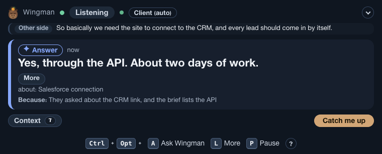
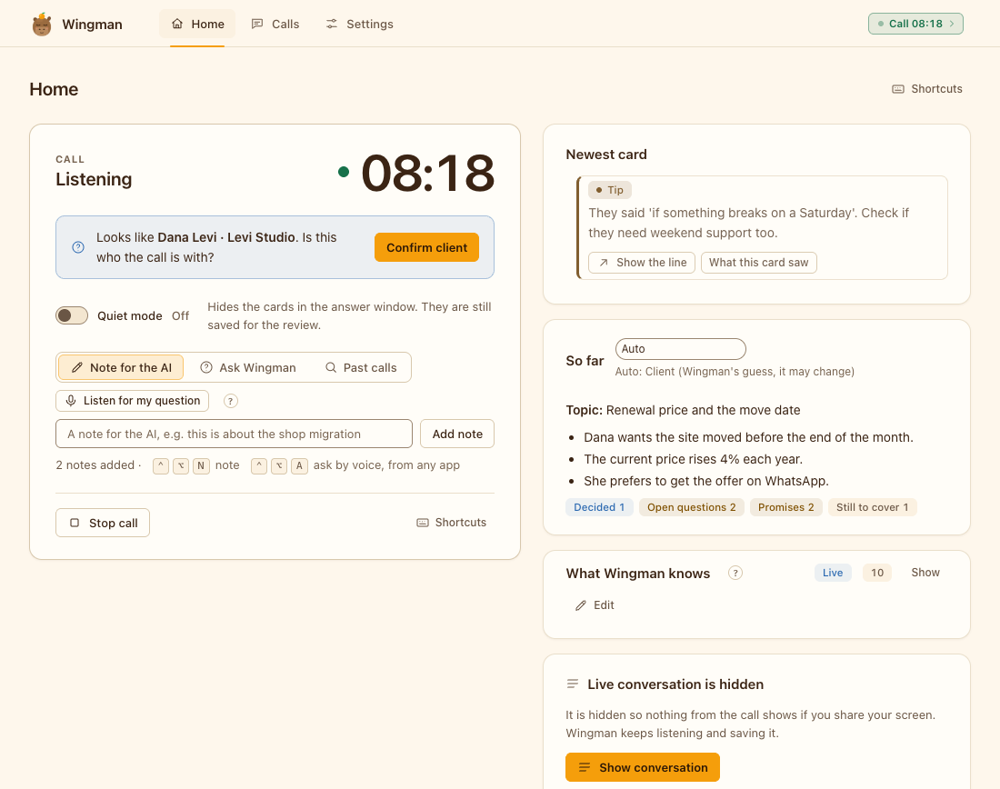
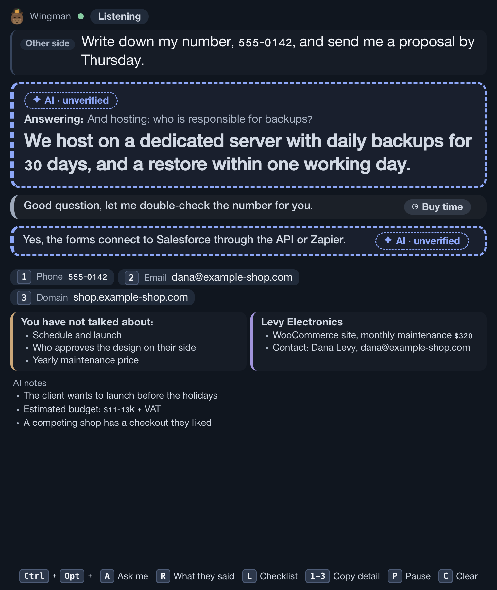
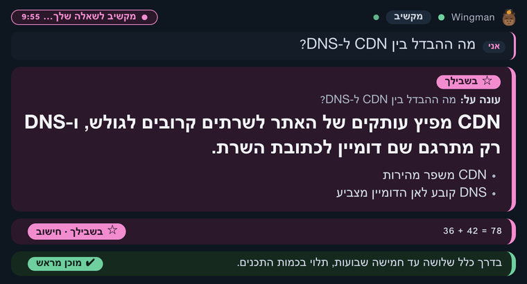
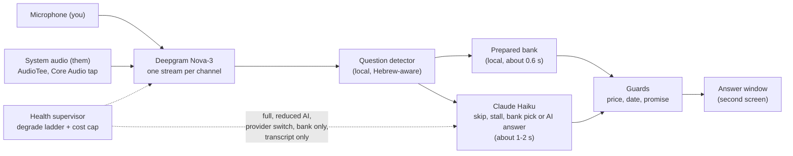

<h1 align="center">Wingman</h1>

<p align="center"><b>Real-time answer cards for live calls. Hears both sides, shows a short answer in about a second.<br>macOS, Electron, TypeScript.</b></p>

<p align="center">
  <a href="https://github.com/koren850/wingman/actions/workflows/ci.yml"></a>
  <a href="LICENSE"></a>
  
  
  
</p>

<p align="center">
  
</p>

Wingman is a live call copilot for client, support and team calls. It listens to your call (the other side on system audio, you on the microphone), transcribes it in real time and shows short answer cards on a second screen: a ready-made answer from your own answer bank when the other side asks a common question, or a short AI answer when it does not. After the call it writes a summary and a follow-up email draft. It is Hebrew-first and works in English too (see [Languages](#languages)).

**See it run in a minute, with no keys:** the [offline demo](#try-it-without-keys) replays a scripted call through the real engine.

## Why it is interesting

Latency figures come from the project's own synthetic-voice test rounds, so real calls with room noise will be slower. Everything else can be checked in this repository.

- **Fast, and fast without AI.** Prepared answers from a local bank appear about 0.6 s after the speaker stops (p95 about 1.9 s, including about 0.4 s of speech-to-text lag). Only questions the bank cannot answer go to Claude Haiku, behind a stall line forced at 1.8 s; answers to questions older than 4 s are dropped. See [the latency budget](docs/ARCHITECTURE.md#latency-budget-and-cost-model).
- **Guards are code, not prompts** ([ADR 13](docs/DECISIONS.md#adr-13-guards-are-code-not-prompts)). Deterministic filters for prices, dates and promises sit between the model and the screen. A hit becomes a "buy time" line instead of an invented number. Practice mode adds a salary guard and an unclaimed-term guard.
- **Built for live audio that goes wrong.** Two audio channels, so the speaker is always known. A ring buffer replays the last 2 s after a reconnect. A circuit breaker and a six-rung degrade ladder (full, reduced AI, provider switch, bank only, transcript only, off) keep the call useful when a provider fails ([ADR 24](docs/DECISIONS.md#adr-24-a-degrade-ladder-and-cost-caps)). A per-call spend cap drops the model while prepared cards keep working.
- **Hebrew-first.** A Hebrew-aware question detector, Unicode whole-word matching, English technical terms mixed in, and a right-to-left aware answer window.
- **Tested without a live call.** 600+ tests in 57 files, an offline end-to-end replay with scripted speech and AI, and a synthetic QA harness with 32 invented scenarios rendered to audio. Quality gates use numbers ([ADR 3](docs/DECISIONS.md#adr-3-numeric-gates-instead-of-opinions)); see [Evaluation](#evaluation). Line coverage is about 89% (84% branch) over the `src/`, `shared/` and `tray/` files the tests load (`pnpm test:coverage`); the Electron window code is exercised by snapshot tools, not unit tests.
- **Private by design, decided in writing.** No telemetry, no cloud account, audio never stored. [docs/DECISIONS.md](docs/DECISIONS.md) holds 37 design records with context, alternatives and consequences, including what was left out on purpose ([ADR 35](docs/DECISIONS.md#adr-35-scope-no-real-job-interviews-or-exams), [ADR 36](docs/DECISIONS.md#adr-36-web-lookup-is-not-built)).

## Screenshots

| Answer window | Main window |
|---|---|
|  |  |

All screenshots use invented data. The answer window with English labels, and with Hebrew cards (it turns right-to-left by itself):





The Hebrew card above answers the question "What is the difference between a CDN and DNS?": a CDN spreads copies of the site to servers near the visitor, and DNS only translates a domain name into the server's address.

## Features

| Feature | What it does |
|---|---|
| **Prepared** cards | A local answer bank (your pack's `bank.yaml`) answers common questions in about 0.6 s, with no AI call. |
| **AI** cards | When the bank has nothing, a small Claude model writes a short answer, always marked "not verified". |
| **Buy time** lines | For prices, dates and promises Wingman never invents a number. It shows a safe line such as "I will check and come back with a proper price". |
| **For you** and math | Ask out loud (Ctrl+Opt+A) and get an answer in its own card. Arithmetic, in Hebrew or English, is computed locally. |
| **Call frame, tips and checklist** | Detects what kind of call it is, keeps a checklist of what it should cover and shows at most one tip every two minutes. |
| **Flow mode** | Tells several speakers apart. When they talk among themselves, cards wait; when someone turns to you, an alert shows who. |
| **Practice and prep mode** | Rehearse with a pretend client and your own notes, then review. See [Responsible use](#responsible-use). |
| **Summary** | Summary, decisions, next steps, open questions and a follow-up email draft. Prices and promises become placeholders for you to fill in. |
| **Health and fallbacks** | A visible bar when something degrades, and a ladder that keeps the call going. See [How it works](#how-it-works). |
| **Menu-bar app and CLI** | Home, Calls and Settings in an Electron app, a guided first-run setup, a readiness check and a `wingman` command line. |

More in the [user guide](docs/USER-GUIDE.md) and the [operator guide](app/README.md).

## How it works



Two audio channels go to the speech service, one per side, so Wingman always knows who said what. A local detector decides whether a line from the other side is a question. The bank is tried first because it is fast, free and written by you. A small AI model decides whether to skip, stall, pick a bank card or write an answer, and every AI line passes the code guards before it can be shown. If a provider fails or the spend cap is reached, the health supervisor steps down a rung between questions, and steps back up when things are stable. Details: [docs/ARCHITECTURE.md](docs/ARCHITECTURE.md).

## Evaluation

Everything below runs offline, with no API keys and no private data.

| Component | Test set | Result |
|---|---|---|
| Question detector (Hebrew, local) | 60 labelled lines (30 question, 30 not) | precision 100%, recall 100% |
| Question detector on call scenarios | 217 labelled turns from 32 synthetic calls | precision 96.9%, recall 100% (4 false positives, 0 misses) |
| Answer-bank matcher | 40 held-out utterances | top-1 93% (37/40), wrong card 3% (1/40), no card 5% (2/40) |
| Guards (price / date / promise) | 64 must-block, 29 must-pass sentences | 64/64 blocked with the right rule, 0/29 false positives |
| Practice-mode salary guard | 12 must-block, 6 must-pass | 12/12, 0/6 |
| Whole suite | 600+ tests | all pass in about 5 min (about 20 s without the subprocess end-to-end tests) |

Reproduce: `cd app && pnpm eval` prints the detector and guard tables. The older commands still work: `pnpm detector` (detector corpus), `pnpm banktest` (bank matcher) and `pnpm test` (the full suite).

Caveats: the sets are small and were used while tuning, so treat them as regression gates, not as generalisation estimates. They are Hebrew-first: English coverage is thinner. Reply latency (p50 about 0.6 s for prepared cards) comes from the project's own synthetic-voice runs; the live model is only called by `pnpm qa`, which needs paid keys.

## Tech stack

| Layer | Technology | Why |
|---|---|---|
| Engine | TypeScript on Node 24 (tsx), zod | One typed process per call; plain JSONL files, no database |
| Speech to text | Deepgram Nova-3 (Soniox and Gladia adapters, experimental) | Streaming, per-channel, handles Hebrew with English terms |
| AI | Claude Haiku through the Vercel AI SDK | Low time to first token; prompt prefix cached |
| System audio | AudioTee (Core Audio tap), ffmpeg for the microphone | No virtual audio driver needed |
| App | Electron (menu-bar app, window, answer window) | Content protection and second-screen placement |
| Tests and CI | Node test runner, GitHub Actions on macOS | Offline end-to-end replay, synthetic QA |

## Quick start

Needs **macOS 14.2 or newer** (system audio uses a Core Audio tap), **Node 24 or newer** (the installer does not install it), `ffmpeg` (microphone capture; the installer offers `brew install ffmpeg`), pnpm 11 (comes with corepack, which the installer turns on) and a **second screen** (with one screen the answer window refuses to open, so it cannot end up in a screen share). Optional: `poppler` to attach PDF files to a meeting. For live calls you also need a Deepgram and an Anthropic API key (next section). Windows and Linux: see [Platform support](#platform-support).

```bash
brew install node@24                       # skip if you already have Node 24
git clone https://github.com/koren850/wingman.git
cd wingman && ./install.sh                 # checks the Mac, installs, builds Wingman.app
```

`./install.sh --check` shows what is present and changes nothing; `--dry-run` shows every step; `--uninstall` removes it. The installer never uses sudo and asks before it copies the app to `/Applications`, adds the `wingman` command in `~/.local/bin` or runs `brew install ffmpeg`. Put `~/.local/bin` on your PATH (`export PATH="$HOME/.local/bin:$PATH"` in `~/.zshrc`).

Then open **Wingman**. A guided setup walks you through keys, your name, permissions, microphone, screens, the answer pack, a readiness check and a **practice call** (a pretend client; free, offline, no keys needed). Full steps: [docs/USER-GUIDE.md](docs/USER-GUIDE.md#first-run). Problems: [docs/TROUBLESHOOTING.md](docs/TROUBLESHOOTING.md).

### Languages

Hebrew first, English works, other languages are untested. The shipped example answer pack, the practice call and the offline demo are **Hebrew** (`app/data/example-pack/bank.en.yaml` is the English version of the pack). The answer window's labels follow `ui.language`: the default `auto` shows Hebrew labels, so set `ui.language: en` (Settings, answer window language) to get English labels.

### Try it without keys

The offline demo plays a scripted, invented Hebrew call (a client asking about a slow shop, backups and a price) through the real engine, with scripted speech and scripted AI. It needs no keys and makes no network calls. Run it from `app/`:

```bash
cd app
ffmpeg -f lavfi -i anullsrc=r=16000:cl=stereo -t 90 /tmp/wingman-silence.wav   # the replay clock; its audio is ignored
WINGMAN_STT_SCRIPT=data/demo/demo-call.json WINGMAN_SCRIPT_GAP_MS=3000 \
  pnpm start --profile demo --file /tmp/wingman-silence.wav --no-brief
```

Cards print in the terminal as they would appear in the answer window (add `pnpm overlay` in a second terminal for the window). The status line ends with the spend: the demo uses no AI, so it reads `AI $0.000`, and the number after "of" is your per-call cap (default $2, see [Cost](#cost)). The same call runs from the app as the **Practice call** button.

### Get your API keys

Live calls need two keys, both paid services billed to you by the provider:

1. **Deepgram** (speech to text): sign up at [console.deepgram.com/signup](https://console.deepgram.com/signup). New accounts have usually received free starting credit; check their pricing page. Create an API key in the console.
2. **Anthropic** (the AI): create an account at [platform.claude.com](https://platform.claude.com) (the old console.anthropic.com address redirects there), add a few dollars of credit under Billing, and create a key under [Settings, API keys](https://platform.claude.com/settings/keys).

Paste both keys into the first-run setup (step 1, "Keys") or later in **Settings, Keys**. They are stored in the macOS Keychain. From a terminal you can use `pnpm keys set deepgram` and `pnpm keys set anthropic`. Never put keys in the repo.

### Cost

About $1.10 an hour of call for speech (Deepgram Nova-3, two channels at about $0.55 per hour each) plus roughly 5 to 20 cents an hour for AI: about $1.20 an hour in total. A per-call cap (`budget.maxUsdPerCall`, default $2) limits AI spend. Prices in the config are estimates; check your providers' price pages. See [the cost model](docs/ARCHITECTURE.md#latency-budget-and-cost-model).

### Fresh Mac

On a Mac with no developer tools, install them first (each step is skipped if you already have it):

```bash
xcode-select --install                                  # Xcode Command Line Tools (git); finish the dialog that opens
/bin/bash -c "$(curl -fsSL https://raw.githubusercontent.com/Homebrew/install/HEAD/install.sh)"   # Homebrew, from brew.sh
eval "$(/opt/homebrew/bin/brew shellenv)"               # Apple silicon: puts brew on PATH for this shell (the installer prints the permanent line)
brew install node@24 && brew link --overwrite node@24   # Node 24 (or: nvm install 24)
corepack enable                                         # gives you pnpm; ./install.sh also does this
brew install ffmpeg                                     # microphone capture and file replay
brew install poppler                                    # optional: attach PDF files to a meeting
```

Then run the `git clone` and `./install.sh` lines above.

**First launch.** The app you build is ad-hoc signed, not notarised, so macOS may refuse to open it the first time. Right-click `Wingman.app` and choose **Open**, then confirm. Or try to open it once, then go to **System Settings, Privacy & Security**, scroll to the message about Wingman and click **Open Anyway**.

**Permissions.** Wingman asks for **Microphone** (your voice) and **System Audio Recording** (the other side of the call). macOS may also ask to allow notifications, which is optional. It does not need Screen Recording, Accessibility or Camera. After you allow System Audio Recording, quit and reopen Wingman. The guided setup walks through both.

## Privacy and security

- Audio goes to **Deepgram** to be transcribed, together with hints taken from your meeting plan (names) and word list. Text of the call goes to **Anthropic** for AI answers and the summary. Nothing else leaves your Mac: no telemetry, no analytics, no update check, no cloud account. Audio is **never saved**; transcripts and cards stay in `~/Library/Application Support/Wingman/calls/<id>/` with owner-only permissions until you delete them.
- **Sandboxed windows, narrow IPC.** Context-isolated windows with a strict Content-Security-Policy, permission requests denied, navigation, popups and redirects blocked, no `innerHTML` or `eval`. Every IPC call checks the sender and validates its arguments; the API-key box is write-only (only the last 4 characters ever come back).
- **Keys in the macOS Keychain**, written through stdin (never argv or environment), read back to verify, and removed from the engine's environment before child processes start. Keychain note: keys are stored through `/usr/bin/security`, so other programs you run as the same macOS user can read them without a prompt. It protects against file copies and backups, not against malware running as you.
- **Owner-only control socket** (directory 700, socket 600, owner-checked, with size, time, count and rate limits), a fixed command list, and native confirmation dialogs for starting or deleting a call from the command line, which a script cannot click.
- **No shell anywhere:** every child process takes an argument array. Attachments are read symlink-safe (O_NOFOLLOW, extension allow-list, secret-folder refusals). Electron fuses for RunAsNode, NODE_OPTIONS and inspect are switched off at build time, and the build fails if they cannot be set.
- **LLM safety by design.** The model has no tools, so it cannot act. Untrusted text is wrapped and tag-stripped until stable; model output is sanitised and guarded (prices, dates and promises become placeholders; unknown links and phone numbers in the email draft are neutralised).
- **Private by default:** umask 077, mode 700/600 on every write, audio never stored.
- **Supply chain:** sha512 lockfile with no tarball URLs, two allowed build scripts, checksum-verified Electron download, GitHub Actions pinned to commit SHAs with a read-only token, Dependabot. The one closed binary, [AudioTee](https://github.com/makeusabrew/audiotee) (a prebuilt, ad-hoc-signed helper whose npm package ships no source), is pinned by hash in `pnpm-lock.yaml` and disclosed; review it before a dependency update.
- **Deepgram model improvement.** By default Deepgram may use audio for its model improvement program. Turn on `stt.deepgram.mipOptOut` to opt out (it may cost more).
- **Honest docs:** a "What leaves your Mac" table, a "Known gaps" list and a private vulnerability-reporting policy, backed by dedicated security test suites.

Full details: [docs/PRIVACY-AND-SECURITY.md](docs/PRIVACY-AND-SECURITY.md) and [SECURITY.md](SECURITY.md).

## Responsible use

Tell the other people on the call that you use Wingman, and follow the recording and privacy laws that apply to you (some places require everyone's consent). It is not a recording or consent tool and gives no legal advice. Do not use it where outside help is forbidden, such as exams or job interviews that prohibit assistance: practice and prep mode is for rehearsal with your own notes ([ADR 35](docs/DECISIONS.md#adr-35-scope-no-real-job-interviews-or-exams), [user guide](docs/USER-GUIDE.md#practice-and-prep-mode)).

## Platform support

| Platform | Status |
|---|---|
| macOS 14.2 or newer | Supported: the full app, live calls and the installer. |
| Windows, Linux | The engine and file replay (`--file`) are being made to run there; live system-audio capture, the menu-bar app and the installer are macOS only. **Help wanted.** See [CONTRIBUTING.md](CONTRIBUTING.md). |

Limits: Wingman needs the internet and both keys for live calls, and its answers are hints, not facts. More in the [roadmap](docs/ROADMAP.md).

## Documentation

| Doc | Read it for |
|---|---|
| [docs/USER-GUIDE.md](docs/USER-GUIDE.md) | First run, updating, where files live, profile and pack, practice mode, flow mode, command line |
| [docs/ARCHITECTURE.md](docs/ARCHITECTURE.md) | Components, data flow, call lifecycle, files, latency and cost, tests |
| [docs/DECISIONS.md](docs/DECISIONS.md) | 37 architecture decision records: what was chosen and why |
| [docs/PRIVACY-AND-SECURITY.md](docs/PRIVACY-AND-SECURITY.md) | What data goes where, what is stored, how keys are handled |
| [docs/DEVELOPMENT.md](docs/DEVELOPMENT.md) | Setup, scripts, tests, QA harness, snapshot tools, building the app |
| [docs/TROUBLESHOOTING.md](docs/TROUBLESHOOTING.md) | No sound, permissions, install problems, slow AI, disk, sleep |
| [docs/PACK-FORMAT.md](docs/PACK-FORMAT.md) | How to write your answer cards and word lists |
| [docs/ROADMAP.md](docs/ROADMAP.md) | Verification status, known limits, ideas |
| [app/README.md](app/README.md) | The detailed app and operator guide: settings, hotkeys, commands |
| [brand/README.md](brand/README.md) | The capybara logo and how the icons are built |
| [CONTRIBUTING.md](CONTRIBUTING.md) | Setup, tests, commit style, no private data |
| [SECURITY.md](SECURITY.md) | How to report a vulnerability |
| [CHANGELOG.md](CHANGELOG.md) | Release notes |

The repository has `install.sh` (installer), `app/` (engine `src/`, menu-bar app `tray/`, window `dashboard/`, answer window in `overlay/`, QA `qa/`, settings `config/`, shipped data `data/`), `docs/`, `brand/` and `.github/`.

## Contributing

Issues and pull requests are welcome; small focused changes are the easiest to review. Read [CONTRIBUTING.md](CONTRIBUTING.md) first (setup, checks, commit style, and the rule that no real people, companies or call data go in the repo). Please follow the [Code of Conduct](CODE_OF_CONDUCT.md) and report vulnerabilities privately as described in [SECURITY.md](SECURITY.md).

## How it was built

Built by [the author](https://github.com/koren850/wingman) with Claude Code as a pair-programming agent; design decisions are recorded in [docs/DECISIONS.md](docs/DECISIONS.md).

## License

MIT, see [LICENSE](LICENSE).
