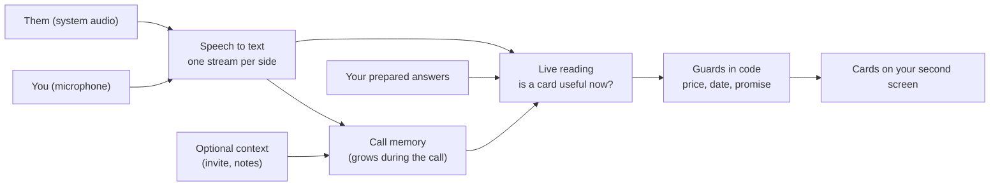

<h1 align="center">Wingman</h1>

<p align="center"><b>A live agent for your meetings. It listens, builds context as the meeting goes, and shows short help cards from what happens.</b><br>A macOS app for English and Hebrew calls, built with Electron and TypeScript.</p>

<p align="center">
  <a href="https://github.com/koren850/wingman/actions/workflows/ci.yml"></a>
  <a href="LICENSE"></a>
  
</p>

<p align="center">
  
</p>

Wingman is a live agent for client, support and team meetings. Before a meeting you can give it context: an invite, an email, notes. That is optional. During the meeting it builds context by itself, like a Claude session that listens: who is on the call, what was decided, which numbers were said, what you promised. From what happens, it shows short cards on a second screen. A card can answer a question, warn that a number does not match your notes, or remind you of a topic you wanted to cover. After the call it writes a summary and a follow-up email draft.

A **moment** is a point in the call where a short, private nudge would help: a question, an objection, a number, a promise, an open point. Wingman looks at the call as a whole and decides, moment by moment, whether a card helps. Most lines get no card. It does not wait for a question mark. The old lists of question words are only a hint and the offline fallback.

## What you get

- **Live reading is the default.** The AI reads the call as it grows and decides when to help. **Classic** (the older question gate) is a setting you can switch back to if live reading misbehaves. It also runs, without AI, when the AI is down.
- **Cards that stay short.** Answer, Check, Prompt and Fact cards. A line is shown whole. Low-confidence cards become small chips, and "Fewer like this" teaches Wingman what you do not want.
- **Your own answers first.** A local pack of prepared answers shows in about 0.6 s with no AI call. Prices, dates and promises are checked in code, never invented.
- **Call kinds and modes.** Wingman guesses the kind of call (client, support, team, practice and others) and adjusts how much it says. You can lock the kind or write your own mode.
- **A practice call first.** A pretend client plays through the real window. It is free and needs no keys.
- **English and Hebrew**, also mixed in one call, with right-to-left text.

## Quick start

Needs macOS 14.2 or newer, Node 24, a second screen for the answer window, and (for live calls) a Deepgram key and an Anthropic key.

```bash
git clone https://github.com/koren850/wingman.git
cd wingman && ./install.sh        # checks the Mac, installs, builds Wingman.app
```

1. **Install the app.** Open Wingman. The setup has three steps: Try it, Connect (paste the two keys), Allow (microphone and system audio).
2. **Try a practice call.** Press Practice call. A pretend client talks and the cards appear. No keys, nothing leaves your Mac.

No Mac at hand? `cd app && WINGMAN_SKIP_APP=1 pnpm install && pnpm demo` plays a scripted call in the terminal. Full steps: [Getting started](docs/GETTING-STARTED.md). Developers: [DEVELOPMENT.md](docs/DEVELOPMENT.md).

## How it works



Two audio streams keep who said what. A shared call memory (topic, numbers, promises, open questions) feeds every AI call. A health ladder keeps the call useful when a service fails: without AI, prepared answers and the language-neutral floor still work. More: [Architecture](docs/ARCHITECTURE.md).

## How good is it? Scripted and recorded numbers

Every number below is **scripted**: the AI replies are fixtures, so the numbers prove the plumbing, the timing and the grader, not the AI's judgement. **There is no recorded run of live reading yet.** The owner records one with `pnpm morning --cap 5` ([morning kit](docs/MORNING-KIT.md)). Until then no quality score here is a release score.

| What | Result (scripted) |
|---|---|
| 32 invented dev meetings (the set we tuned on) | card recall 84.6%, precision 79.7%, duplicates 1.0%, 82 cards an hour |
| 8 invented meetings written for the blind split `test-c` (not truly blind, see [ROADMAP](docs/ROADMAP.md)) | recall 91.9%, precision 73.9% |
| Ship thresholds ([`qa/ship.json`](app/qa/ship.json)), dev | 8 of 14 scored lines pass, 6 fail (precision of all, answer, prompt and fact cards; cards per hour; wrong-language rate) |
| AI paused, the floor alone, dev replay | 60 of 68 answer moments get a card |
| Modelled AI cost | about $0.03 an hour (limit $0.25) |

Speech costs about $1.40 an hour, so a call is about $1.50 an hour in total (an estimate). Details and the old Classic checks: [ROADMAP](docs/ROADMAP.md).

## Privacy and responsible use

Audio goes to Deepgram to be transcribed. Call text goes to Anthropic for cards and the summary. Nothing else leaves your Mac: no telemetry, no account. Audio is never saved. Tell the people on the call that you use an assistant, and follow the recording laws that apply to you. Practice mode is for rehearsal, not for real exams or interviews. Details: [Privacy and security](docs/PRIVACY-AND-SECURITY.md).

## Guides

[Getting started](docs/GETTING-STARTED.md) · [User guide](docs/USER-GUIDE.md) · [Pack format](docs/PACK-FORMAT.md) · [Examples](docs/EXAMPLES.md) · [Troubleshooting](docs/TROUBLESHOOTING.md) · [Morning kit](docs/MORNING-KIT.md) · [Architecture](docs/ARCHITECTURE.md) · [Decisions](docs/DECISIONS.md) · [Roadmap and known limits](docs/ROADMAP.md) · [Development](docs/DEVELOPMENT.md) · [Settings and hotkeys](app/README.md) · [Changelog](CHANGELOG.md) · [Contributing](CONTRIBUTING.md) · [Security](SECURITY.md)

## Platforms

macOS 14.2 or newer is supported. The engine and the offline demo also run on Linux (CI); Windows passes the unit tests but has no audio capture yet. Help wanted.

## Languages

English and Hebrew, and calls that mix them. Other languages are not supported yet: Wingman shows a one-time notice and gives no cards for those lines.

## How it was built

Wingman is a solo project by [koren850](https://github.com/koren850), built with [Claude Code](https://claude.com/claude-code) as the coding agent. The decisions, trade-offs and quality bars are written down in [docs/DECISIONS.md](docs/DECISIONS.md). MIT license, see [LICENSE](LICENSE).
