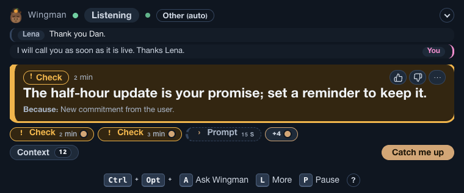
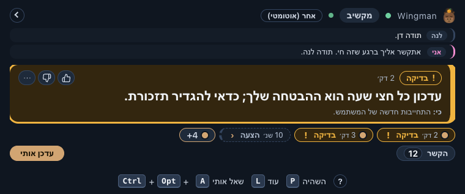
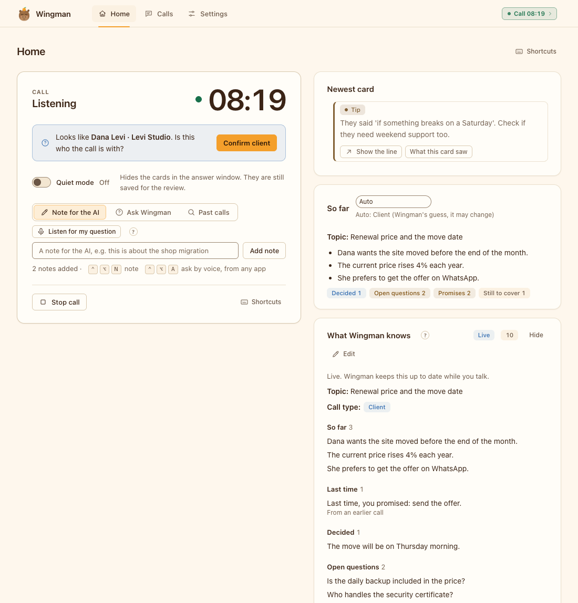
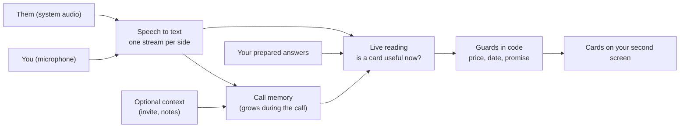

<h1 align="center">
  <picture>
    <source media="(prefers-color-scheme: dark)" srcset="brand/png/lockup-dark.png">
    
  </picture>
</h1>

<p align="center"><b>A live agent for your meetings. It listens, builds context as the meeting goes, and shows short help cards from what happens.</b></p>

<p align="center">
  <a href="https://github.com/koren850/wingman/actions/workflows/ci.yml"></a>
  <a href="LICENSE"></a>
  
</p>

<p align="center">
  
</p>

<p align="center">
  
  
</p>

Wingman is a desktop app for English and Hebrew calls, for macOS and Windows. It is a live agent for client, support and team meetings. Before a meeting you can give it context: an invite, an email, notes. That is optional. During the meeting it builds context by itself, like a Claude session that listens: who is on the call, what was decided, which numbers were said, what you promised. From what happens, it shows short cards on a second screen. A card can answer a question, warn that a number does not match your notes, or remind you of a topic you wanted to cover. After the call it writes a summary and a follow-up email draft.

A **moment** is a point in the call where a short, private nudge would help: a question, an objection, a number, a promise, an open point. Wingman looks at the call as a whole and decides, moment by moment, whether a card helps. Most lines get no card. It does not wait for a question mark. Old lists of question words are kept only as a hint and for the case when the AI is down.

## What you get

- **Live reading is the default.** The AI reads the call as it grows and decides when to help. **Classic** (the older question gate) is a fallback in the advanced settings. A language-neutral floor keeps working, without AI, when the AI is down.
- **A memory of the call.** A small model keeps short notes: topic, people, numbers, promises, open questions. Every AI call reads them.
- **Cards that stay short.** Answer, Check, Prompt and Fact cards. A line is shown whole. Low-confidence cards become small chips, and "Fewer like this" teaches Wingman what you do not want.
- **Your own answers first.** A local pack of prepared answers shows with no AI call. Prices, dates and promises are checked in code, never invented.
- **A practice call first.** A pretend client plays through the real window. It is free and needs no keys.
- **English and Hebrew**, also mixed in one call, with right-to-left text.

## Install

Download the app from the [latest release](https://github.com/koren850/wingman/releases/latest). You install nothing else: no Node, no Homebrew, no ffmpeg. You need a second screen for the answer window, and two API keys for live calls (see [The two keys](#the-two-keys)). The practice call needs no keys.

Both downloads are **not signed yet**, so your system warns you once. This is expected. The steps are below.

### macOS (14.2 or newer, Apple Silicon)

1. Download `Wingman-<version>-arm64.dmg` and open it.
2. Drag **Wingman** onto **Applications**.
3. Open **Applications** and double-click **Wingman**. macOS says it cannot verify the app. Press **Done** (not "Move to Bin").
4. Open **System Settings, Privacy & Security** and scroll down to **Security**. You see "Wingman was blocked". Press **Open Anyway**, enter your password or use Touch ID, and press **Open Anyway** once more.
5. Wingman starts and its window opens. You do this once; later starts open normally.

On macOS 15 and newer, right-click, **Open** no longer works for this. If the steps above do not work, run this in Terminal once, then open the app again: `xattr -dr com.apple.quarantine /Applications/Wingman.app`.

### Windows (10 or 11, 64-bit) - beta

Windows is a **beta**: the installer is built and checked, but nobody has yet tested the sound capture on a real Windows PC. It may fail; please report what you see.

1. Download `Wingman-Setup-<version>-x64.exe` and run it.
2. If Windows shows "Windows protected your PC" (SmartScreen), press **More info**, then **Run anyway**.
3. The installer asks for no administrator rights. It installs for your user, adds a Start menu shortcut and starts Wingman.
4. The Wingman icon lives in the notification area (the system tray, bottom right; it may be under the small arrow).

To remove it, use Settings, Apps, Wingman. Your calls and notes stay in `%APPDATA%\Wingman` until you delete that folder.

The Windows app records the microphone and the system audio itself. Audio capture has only been tested with fakes, not yet on a real Windows machine. Help wanted.

### The two keys

Wingman needs two keys. The first window asks for them and checks each with one small request before it saves it.

| Key | What it does | Where to get it | Cost |
|---|---|---|---|
| Deepgram | Turns the call audio into text | [console.deepgram.com/signup](https://console.deepgram.com/signup), then create a key in the console | About $1.30 to $1.40 an hour of call |
| Anthropic | The AI (Claude) that reads the call and writes cards | [platform.claude.com](https://platform.claude.com): add credit under Billing, then create a key under [Settings, API keys](https://platform.claude.com/settings/keys) | About 5 to 20 cents an hour |

A call costs about $1.50 an hour in total. Speech to text is most of it. These are estimates; check both price pages. A cap per call (`budget.maxUsdPerCall`, $2 by default) limits the AI spend. Set a spend limit in both consoles too. Keys are kept in the macOS Keychain, or encrypted for your Windows account. They are never saved in a plain file.

### First run

1. **Your two keys.** Paste both and press **Check and save**.
2. **Let Wingman hear.** macOS: allow the microphone, switch on System Audio Recording for Wingman in System Settings (if Wingman is not listed, start a real call once and press Allow when macOS asks), then quit and open Wingman again. Windows: only the microphone switch; the sound of the call needs no permission.
3. **Ready.** Press **Start a practice call**. A pretend client talks and the cards appear. No keys needed, and nothing leaves your computer. When you are ready, press **Start a real call**.

Full steps and pictures: [Getting started](docs/GETTING-STARTED.md). If something fails: [Troubleshooting](docs/TROUBLESHOOTING.md).

### Build from source

Only developers need this. Node is needed to build and run the code, not to use the app.

You need Node 24 or newer, git and (on a Mac) macOS 14.2 or newer. Windows steps are in [DEVELOPMENT.md](docs/DEVELOPMENT.md).

```bash
git clone https://github.com/koren850/wingman.git
cd wingman && ./install.sh        # macOS: checks the Mac, installs, builds Wingman.app
```

No Mac at hand? `cd app && WINGMAN_SKIP_APP=1 pnpm install && pnpm demo` plays a scripted call in the terminal (about 1 to 2 minutes; run pnpm from `app/` so corepack uses the pinned version). Developers: [DEVELOPMENT.md](docs/DEVELOPMENT.md).

## How it works



Two audio streams keep who said what. A shared call memory (topic, people, numbers, promises, open questions) is updated while the call runs (at most every 20 seconds, when enough new words were said) and feeds every AI call, so the AI knows what happened earlier in the call. Optional context you add before the meeting is the first thing in that memory. A health ladder keeps the call useful when a service fails: without AI, prepared answers and the language-neutral floor still work. More: [Architecture](docs/ARCHITECTURE.md).

## How good is it?

This is an early release (v0.0.1). Read this before you rely on it.

- The plumbing works. In short test calls with the real speech service and the real AI (invented scripts, text-to-speech voices), nothing crashed, questions in English and Hebrew were heard, a prepared card showed in under a second, and an AI card in about 1 to 3.5 seconds (slow cases took up to about 5 seconds).
- Speech to text was right for about 92 percent of the words in English and 77 to 83 percent in Hebrew, on those synthetic voices.
- Card quality is not proven. A replay of the real AI against 32 invented test meetings passes 3 to 6 of 16 release lines (the result moves between recordings): cost and language pass, but too few cards hit the expected moment (precision about 10 percent, recall about 5 percent), and a model judge rated a quarter to a third of the cards useful. Treat every card as a hint and check it before you say it. The numbers are on the [Roadmap](docs/ROADMAP.md#evidence-so-far).

Cost, measured in short test calls: about $1.40 an hour in total, of which about 90 percent is speech to text. The AI part is about 5 to 20 cents an hour.

## Privacy and responsible use

Audio goes to Deepgram to be transcribed. Call text goes to Anthropic for cards and the summary. By default nothing else is sent: no telemetry, no account. Three opt-in features contact the hosts you give them: a web address as context, a calendar .ics link, and web lookup (off by default). Audio is never saved. Tell the people on the call that you use an assistant, and follow the recording laws that apply to you. Practice mode is for rehearsal, not for real exams or interviews. Details: [Privacy and security](docs/PRIVACY-AND-SECURITY.md).

## Guides

- Use it: [Getting started](docs/GETTING-STARTED.md), [User guide](docs/USER-GUIDE.md), [Call-day checklist](app/CALL-DAY.md), [Troubleshooting](docs/TROUBLESHOOTING.md)
- Make it yours: [Pack format](docs/PACK-FORMAT.md), [Examples](docs/EXAMPLES.md), [Settings and hotkeys](app/README.md)
- How it works: [Architecture](docs/ARCHITECTURE.md), [Decisions](docs/DECISIONS.md), [Privacy and security](docs/PRIVACY-AND-SECURITY.md)
- Project: [Roadmap and known limits](docs/ROADMAP.md), [Changelog](CHANGELOG.md), [Development](docs/DEVELOPMENT.md), [Recording evals](docs/RECORDING-EVALS.md), [Contributing](CONTRIBUTING.md), [Security](SECURITY.md)

## Platforms

macOS 14.2 or newer (Apple Silicon) and Windows 10 or 11 (64-bit) have a downloadable app. Both are unsigned for now. The engine and the offline demo also run on Linux (CI), but there is no Linux app. Windows records the microphone and the system audio inside the app (Electron loopback); this path is tested with fakes only and has not run on a real Windows machine yet. Help wanted.

## Languages

English and Hebrew, and calls that mix them. The window and the answer window have both languages, with right-to-left layout. The language of the call is set under Settings, "Language the call is heard in" (`multi` by default, which hears both).

Other languages are not supported yet: Wingman shows a one-time notice and gives no cards for those lines. More languages are planned. Speech to text and the AI already handle many languages, so the work is in Wingman's own language files: the question hints and the price, date and promise guards live in `app/src/lang/`, one file per language, and the window texts live in the `strings` files. The steps are in [DEVELOPMENT.md](docs/DEVELOPMENT.md#adding-a-language).

## How it was built

Wingman is a solo project by [koren850](https://github.com/koren850), built with [Claude Code](https://claude.com/claude-code) as the coding agent. The decisions, trade-offs and quality bars are written down in [docs/DECISIONS.md](docs/DECISIONS.md). MIT license, see [LICENSE](LICENSE).
