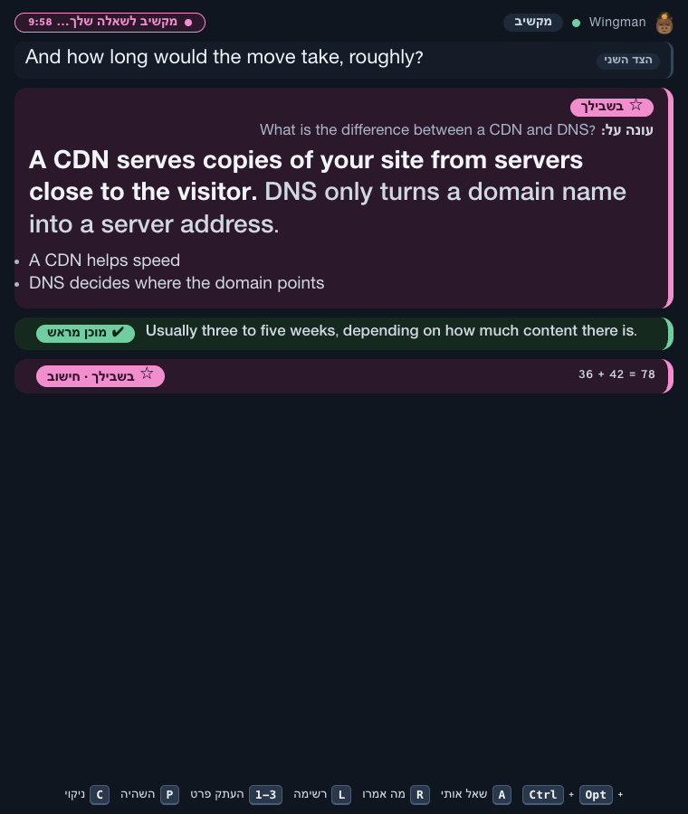

# Wingman

A live meeting assistant for macOS. It listens to your call (the other side on system audio, you on the microphone), transcribes it in real time, and shows short answer cards on a second screen: a ready-made answer from your own answer bank when the other side asks a common question, or a short AI answer when it does not. It also answers questions you ask it out loud, does simple math locally, keeps a checklist of what the call should cover, and writes a summary and follow-up email draft when the call ends. Hebrew (with English tech words mixed in) is the first-class language. The answer bank and house style are your own "pack"; an example web and hosting pack is included. Your name, how to address you and your business go in your profile.



*The answer window on the second screen, with English cards (invented examples). The buttons and labels are Hebrew today. English cards read left to right.*


*The same window with Hebrew cards (invented examples). It turns right-to-left by itself.*

> Wingman is in an early stage ("Stage 0"). It works and is tested, but it is not a polished product. See [Project status](#project-status).

## Key features

| Feature | What it does |
|---|---|
| **Prepared** cards | A local answer bank (your pack's `bank.yaml`; the example pack answers DNS, SSL, backups, slow site...) answers common questions in about half a second, with no AI call. |
| **AI** cards | When the bank has nothing, a small Claude model writes a short answer. AI cards are always marked as not verified. |
| **Buy time** lines | For prices, dates and promises Wingman never invents a number. It shows a safe stalling line ("I will check and come back with a proper price"). |
| **For you** cards | Ask Wingman a question out loud (or press Ctrl+Opt+A) and the answer shows in its own card. |
| **Math** | Arithmetic ("36 plus 42", "15% of 200", Hebrew and English number words) is computed locally. No AI, instant. |
| **Tip** cards | At most one short tip every two minutes (a question to ask, a reminder), never during an answer. |
| **Call checklist** | Wingman works out what the call is about (client, support, vendor, team, consult, personal) and keeps a checklist for that kind of call. |
| **Quick call and prepared meetings** | Start a **quick call** right now with no context, or save several **prepared meetings** (a Plan each: who, goal, notes, must-cover checklist, background files, optional time) and pick one at Start. A prepared meeting is used up by the call you start with it. |
| **Fact cards** | If you build a local snapshot of your clients and domains, a mention of a known client or domain shows what you already know. No network lookups during the call. |
| **Several speakers and flow** | Several people on the other side are told apart ("Speaker 1", 2... or their names, from introductions or the meeting's attendees; rename with `wingman speaker <n> "<name>"`). When they talk among themselves, a muted "talking among themselves" line shows who and about what, and answer cards wait. When someone turns to you, an orange "turned to you" alert shows who. See [Flow mode](#flow-mode). |
| **Interview mode** | A prepared meeting of kind `interview` makes Wingman coach you as the candidate, from your prep notes and an optional file of your own prepared cards. See [Interview mode](#interview-mode). |
| **Important cards only** | On by default (`cards.focus`). A card only for a clear question to you: a question mark, a direct request or your name. At most 2 cards every 2 minutes. Price and date cards and cards about what you said always show. Turn it off in Settings for more cards. |
| **Profile and pack** | Your name, spellings, how to address you and your business live in a profile on your machine, not in the repo. The answer bank, house style and keyterms are a swappable pack. |
| **Capture chips** | Phone numbers, emails and domains spoken in the call appear as copyable chips. |
| **Summary** | After the call: summary, decisions, next steps, open questions and a follow-up email draft. Prices, dates and promises become `[להשלים: ...]` placeholders. |
| **Readiness check** | One command or button that tests mic, system audio, keys, speech service and the AI before you go live. |
| **Health and fallbacks** | A visible bar if something degrades. A degrade ladder keeps the call going (reduced AI, bank only, transcript only). Audio sources restart by themselves, the call survives sleep and a stray error, and Wingman warns when the disk is nearly full. Nothing blocks the call. |
| **Guided setup** | The first time you open the app, a short guide walks you through your keys, your name, permissions, the microphone, your screens, the answer pack, a readiness check and a practice call. |
| **Menu-bar app and CLI** | An Electron menu-bar app with a Home / Calls / Settings window, and a `wingman` command line that drives the running app. |

## How it works

```
mic (you) ----------------+                                   +--> Prepared bank (local, ~0.5 s)
                          +--> Deepgram Nova-3 --> question --+
system audio (them) ------+     speech to text     detector   +--> Claude Haiku (short AI answer
 (AudioTee, macOS)             (two channels)                       or "Buy time" line, ~1-2 s)
                                                                          |
                                                                          v
                                                         guards (no prices, dates, promises)
                                                                          |
                                                                          v
                                                    Answer window on your second screen
```

Two audio channels go to the speech service, one for each side, so Wingman always knows who said what. A local detector decides whether a line from the other side is a question. The bank is tried first because it is fast, free and written by you. A small AI model decides whether to skip, stall, pick a bank card or write an answer. Every AI line passes through code guards before it can be shown. Details: [docs/ARCHITECTURE.md](docs/ARCHITECTURE.md).

## Requirements

- **macOS 14.2 or newer, only.** System audio is captured with AudioTee (a Core Audio tap). There is no Windows or Linux support.
- **Node.js 24 or newer.** The installer does not install it for you.
- **pnpm 11**, which comes through corepack (the installer turns it on).
- **`ffmpeg`** (used for the microphone and for replaying audio files). The installer offers `brew install ffmpeg`.
- Optional: **poppler** (`brew install poppler`) to attach PDF files to a meeting.
- A **Deepgram** API key (speech to text) and an **Anthropic** API key (the AI). Both are paid services. See [costs](docs/ARCHITECTURE.md#latency-budget-and-cost-model): roughly a dollar an hour of call for speech, plus a few cents of AI.
- A second screen is strongly recommended. With one screen the answer window refuses to open (so it cannot end up in a screen share).
- Microphone and System Audio Recording permission for Wingman (or for the terminal that runs it). The guided setup shows you how.

Honest limits: Hebrew-first (English works, other languages are untested); needs the internet and both keys; not a recording or consent tool; answers are hints, not facts.

## Install

```bash
git clone <this repo>
cd <folder>
./install.sh --check     # optional: shows what is present and what is missing; changes nothing
./install.sh             # checks the Mac, installs, builds Wingman.app
```

`install.sh` asks before it does anything extra: copy Wingman.app to `/Applications`, add the `wingman` command in `~/.local/bin`, and `brew install ffmpeg` if it is missing. It never uses sudo. It is safe to run again.

Other flags: `--dry-run` (show every step), `--yes` (accept the default answers), `--offline` (use only the local package cache), `--update`, `--uninstall`. Details are in [docs/DEVELOPMENT.md](docs/DEVELOPMENT.md#install-update-uninstall).

Put `~/.local/bin` on your PATH so the `wingman` command works:

```bash
export PATH="$HOME/.local/bin:$PATH"     # add this line to ~/.zshrc
```

Something went wrong? See [docs/TROUBLESHOOTING.md](docs/TROUBLESHOOTING.md).

## First run

Open **Wingman** (Spotlight or Launchpad). The first window is a guided setup:

1. **Keys.** Paste your Deepgram and Anthropic keys. They go into the macOS Keychain.
2. **About you.** Your name and how to address you. (Also in Settings later.)
3. **Permissions.** Allow the microphone and System Audio Recording. After you allow System Audio Recording, **quit and reopen Wingman**. macOS gives no live status for it.
4. **Microphone.** Pick the one you use. Avoid AirPods for the first call.
5. **Your screens.** With one screen, you can allow the answer window on it. Never share that screen.
6. **Answer pack.** Use the invented example pack, or copy it to your own folder and edit it.
7. **Readiness check.** Tests the mic, system audio, keys, speech service and the AI.
8. **Practice call.** A pretend client plays through the real call loop and the real answer window. Free, and nothing leaves your Mac.

Every step can be skipped and reopened from **Settings, Setup guide**. When you are ready, press **Quick call**, or **Start** on a prepared meeting.

Without the app, from the terminal: `cd stage0 && pnpm dashboard`. See [stage0/README.md](stage0/README.md) for all commands, settings and hotkeys.

Notes:
- `pnpm run doctor`, not `pnpm doctor` (the second one is pnpm's own command).
- Never put keys in the repo. They belong in the Keychain.
- No second screen yet? Turn on the one-screen option in the setup, and never share that screen.

## Update and uninstall

```bash
wingman update                 # git pull (fast-forward only), install, rebuild the app
wingman uninstall              # removes the app copies and the wingman link; your data stays
wingman uninstall --purge      # also deletes your data and settings, after you type DELETE
```

The same work is done by `./install.sh --update` and `./install.sh --uninstall [--purge]`. The app starts from the folder you cloned. If you move that folder, run `./install.sh` again from the new place.

## Where your files live

Nothing about you is stored in this repository.

| Folder | What is there |
|---|---|
| `~/Library/Application Support/Wingman/` | Your data: `calls/` (transcripts, cards, summaries), `briefs/` (prepared meetings, with `briefs/attachments/`), `entities.json` (optional client snapshot). Override with `WINGMAN_DATA_DIR`. |
| `~/.config/wingman/` | `settings.yaml`, `profile.yaml`, `pack/`, and the old `keys.env` if you still have one. |
| macOS Keychain, service `wingman` | Your API keys. |

If you used an older version that kept calls in the repo folder (`stage0/calls`, `stage0/data/private`), the first start **copies** them to the new folder. It never moves or overwrites. The old folders stay until you delete them.

## Profile and pack

- A **profile** file (`~/.config/wingman/profile.yaml`): your name and spellings, how to address you in Hebrew, a short "about", your business and your time zone (for example `Asia/Jerusalem`). Set it in **Settings, About you**, or with `wingman profile set ...` (see `wingman help`).
- A **pack** folder (`~/.config/wingman/pack/`, or `WINGMAN_PACK_DIR`): your answer bank, house style, keyterms and topic words. Without one, the invented example web/hosting pack in `stage0/data/example-pack/` is used. File formats: [docs/PACK-FORMAT.md](docs/PACK-FORMAT.md).

Do not confuse these with a **settings preset** (`stage0/profiles/<name>.yaml`, used with `--profile <name>`). A preset is a set of setting overrides, such as `first-client-call`. It has nothing to do with `profile.yaml`.

## Interview mode

For practising and preparing, and for coaching yourself with your own notes. Create a prepared meeting with kind `interview` (`wingman plan new --kind interview ...`; the kind is set from the command line). Attach your prep notes as background files.

In this mode:

- Every question gets an answer, with no card limit.
- There are no "Buy time" lines.
- Answers are built from your notes only, never invented experience.
- The AI may not write a salary figure. Salary comes only from your own prepared card.
- There are no fact cards and no self-check cards.
- To use your own prepared answers, add the meeting note `Prepared cards: /full/path/cards.yaml`. The file has the same format as the answer bank ([docs/PACK-FORMAT.md](docs/PACK-FORMAT.md#cards-for-an-interview)). For that call it replaces the normal bank. Each meeting can point to its own file.

Many real interviews and exams forbid outside help. Wingman is out of scope for those ([ADR 35](docs/DECISIONS.md#adr-35-scope-no-real-job-interviews-or-exams)). You are responsible for following the rules that apply to you.

## Flow mode

For calls with several people on the other side (needs `stt.speakers`, on by default; turn flow off with `flow.enabled: false`).

- When two or more of them talk to each other and you are quiet, a muted line shows who is talking and about what. Answer cards wait (`flow.holdCards`). Price and date cards, and questions with your name, still show.
- When someone turns to you (says your name, or "you" right after their own discussion), an orange alert shows who.
- Nothing is kept between calls. Names only live for the call.

## Command line

```bash
cd stage0
pnpm -s wingman help         # full help
pnpm -s wingman status       # is the app running, is a call live
pnpm -s wingman start --practice
pnpm -s wingman start --quick           # no Plan; or: wingman plan list, then wingman start --plan <id>
```

After `./install.sh` you can type `wingman ...` from any folder.

The `wingman` command talks to the running menu-bar app over an owner-only local socket. It cannot read API keys. By default the app asks you in a window before it starts a real call that came from the command line (setting `privacy.askBeforeCliStart`), and before it deletes a call.

## Privacy and safety in short

- Audio goes to **Deepgram** to be transcribed. Text of the call goes to **Anthropic** for AI answers and the summary. Nothing else leaves your Mac.
- Audio is **never saved**. Transcripts and cards are saved locally in `~/Library/Application Support/Wingman/calls/<id>/` with owner-only permissions, until you delete them.
- API keys live in the macOS Keychain, not in files.
- **You are responsible for telling the other people on the call** that a transcription and AI tool is running, and for following the recording and privacy laws that apply to you. Wingman is not a consent tool and gives no legal advice.
- Some interviews, exams and meetings forbid outside help. Check the rules before using Wingman there.

Full details: [docs/PRIVACY-AND-SECURITY.md](docs/PRIVACY-AND-SECURITY.md) and [SECURITY.md](SECURITY.md).

## Project status

It is at "Stage 0": the live call loop, the app, the CLI, the summary and the QA harness are built and tested (515 unit tests, plus a synthetic QA harness with 32 invented scenarios that play through real Deepgram and Haiku). It has been verified with synthetic and test calls; the real-call hand tests still open are listed in [docs/ROADMAP.md](docs/ROADMAP.md). A guided first-run setup and an installer script exist. Signed installers, Windows and plugins are not built and will wait until a second real user needs them.

## Repo map

| Path | What is there |
|---|---|
| `install.sh` | The installer, updater and uninstaller |
| `stage0/` | The app: engine (`src/`), menu-bar app (`tray/`), window (`dashboard/`), answer window (`overlay/`), QA harness (`qa/`), settings (`config/`), shipped data (`data/`: example pack, test fixtures) |
| `.github/workflows/` | CI (type check and tests on macOS) |
| `brand/` | Logo, icons and the script that builds them |
| `docs/` | Documentation (below) |
| `docs/ux/` | Screenshots and UX before/after images |
| `CONTRIBUTING.md` | How to help |
| `CHANGELOG.md` | Milestones |

## Documentation

| Doc | Read it for |
|---|---|
| [docs/ARCHITECTURE.md](docs/ARCHITECTURE.md) | Components, data flow, call lifecycle, files, latency and cost, tests |
| [docs/DECISIONS.md](docs/DECISIONS.md) | Decision log: what we chose and why |
| [docs/PRIVACY-AND-SECURITY.md](docs/PRIVACY-AND-SECURITY.md) | What data goes where, what is stored, how keys are handled |
| [docs/DEVELOPMENT.md](docs/DEVELOPMENT.md) | Setup, install, scripts, tests, QA harness, building the app |
| [docs/TROUBLESHOOTING.md](docs/TROUBLESHOOTING.md) | No sound, permissions, install problems, slow AI, disk, sleep |
| [docs/PACK-FORMAT.md](docs/PACK-FORMAT.md) | How to write your answer cards and word lists |
| [CONTRIBUTING.md](CONTRIBUTING.md) | Setup, tests, commit style, no private data |
| [docs/ROADMAP.md](docs/ROADMAP.md) | Open items, known limits, ideas |
| [stage0/README.md](stage0/README.md) | The detailed app and operator guide |

## License

MIT, see [LICENSE](LICENSE).
