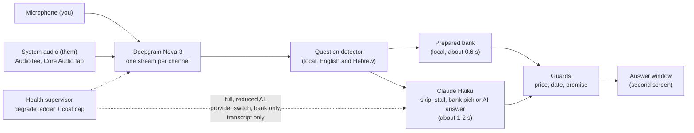

<h1 align="center">Wingman</h1>

<p align="center"><b>Real-time answer cards for live calls, in English and Hebrew. It hears both sides and shows a short answer in about a second.</b><br>A macOS app built with Electron and TypeScript.</p>

<p align="center">
  <a href="https://github.com/koren850/wingman/actions/workflows/ci.yml"></a>
  <a href="LICENSE"></a>
  
  
  
</p>

<p align="center">
  
</p>

Wingman is a live call copilot for client, support and team calls. It listens to your call (the other side on system audio, you on the microphone), transcribes it in real time and shows short answer cards on a second screen: a ready-made answer from your own answer bank when the other side asks a common question, or a short AI answer when it does not. After the call it writes a summary and a follow-up email draft.

It works in English and in Hebrew, including calls that mix the two. Hebrew is a real strength (right-to-left text, Hebrew word forms, English tech terms inside Hebrew speech); other languages are not supported yet (see [Languages](#languages)). The interesting part is how it stays fast and safe on a live call: see [The hard parts](#the-hard-parts).

**See it run in about two minutes, with no keys:** the [offline demo](#try-it-without-keys) replays a scripted call through the real engine.

<p align="center"><sub>
<a href="#the-hard-parts">Hard parts</a> ·
<a href="#examples">Examples</a> ·
<a href="#how-it-works">How it works</a> ·
<a href="#evaluation">Evaluation</a> ·
<a href="#quick-start">Quick start</a> ·
<a href="#try-it-without-keys">Offline demo</a> ·
<a href="#privacy-and-security">Privacy</a> ·
<a href="#guides">Guides</a> ·
<a href="#how-it-was-built">How it was built</a>
</sub></p>

## The hard parts

Latency figures come from the project's own synthetic-voice test rounds, so real calls with room noise will be slower. Everything else can be checked in this repository.

- **Latency budget.** Prepared answers from a local bank appear about 0.6 s after the speaker stops (p95 about 1.9 s, including about 0.4 s of speech-to-text lag). Only questions the bank cannot answer go to Claude Haiku, behind a stall line forced at 1.8 s; answers to questions older than 4 s are dropped. See [the latency budget](docs/ARCHITECTURE.md#latency-budget-and-cost-model).
- **Guards are code, not prompts** ([ADR 13](docs/DECISIONS.md#adr-13-guards-are-code-not-prompts)). Deterministic filters for prices, dates and promises sit between the model and the screen. A hit becomes a "buy time" line instead of an invented number.
- **A degrade ladder for live audio that goes wrong.** Two audio channels, so the speaker is always known. A ring buffer replays the last 2 s after a reconnect. A circuit breaker and a six-rung ladder (full, reduced AI, provider switch, bank only, transcript only, off) keep the call useful when a provider fails ([ADR 24](docs/DECISIONS.md#adr-24-a-degrade-ladder-and-cost-caps)). A per-call spend cap drops the model while prepared cards keep working.

Also:

- **Tested without a live call.** 680+ tests in 70+ files, an offline end-to-end replay with scripted speech and AI, and a synthetic QA harness with 32 invented scenarios rendered to audio. Quality gates use numbers ([ADR 3](docs/DECISIONS.md#adr-3-numeric-gates-instead-of-opinions)); see [Evaluation](#evaluation). Line coverage is about 89% (84% branch) over the `src/`, `shared/` and `tray/` files the tests load (`pnpm test:coverage`); the Electron window code is exercised by snapshot tools, not unit tests.
- **Private by design, decided in writing.** No telemetry, no cloud account, audio never stored on your Mac (it does go to Deepgram to be transcribed, see [Privacy and security](#privacy-and-security)). [docs/DECISIONS.md](docs/DECISIONS.md) holds 37 design records with context, alternatives and consequences, including what was left out on purpose ([ADR 35](docs/DECISIONS.md#adr-35-scope-no-real-job-interviews-or-exams), [ADR 36](docs/DECISIONS.md#adr-36-web-lookup-is-not-built)).

## Screenshots

| Answer window | Main window |
|---|---|
|  |  |

| More panel open | Hebrew card (right-to-left by itself) |
|---|---|
|  |  |

A guided tour of every part of the windows: [docs/USER-GUIDE.md](docs/USER-GUIDE.md#tour-of-the-windows). All screenshots use invented data. The Hebrew card answers "What is the difference between a CDN and DNS?": a CDN spreads copies of the site to servers near the visitor, and DNS only translates a domain name into the server's address.

## Examples

Everything here is invented. The terminal output is real, trimmed to the card lines: it comes from the [offline demo](#try-it-without-keys) (`pnpm demo` for the English call, `pnpm demo --he` for the Hebrew one), which prints cards the way the answer window shows them.

**1. A prepared card.** The client says: "We have a WooCommerce shop and the site has been really slow lately, why does that happen?" A trigger in the answer bank matches, so a card shows at once and no AI is called.

```text
[📗 prepared] A slow site is usually heavy images, missing cache, heavy plugins or a weak server. We check the cause first and then fix it.
   • Common causes: images, plugins, server
   • Measure before and after
   • Not always the server
```

The same question in Hebrew gives the Hebrew card (`pnpm demo --he`):

```text
[📗 prepared] אתר איטי בדרך כלל נובע מתמונות כבדות, חוסר ב-cache, תוספים כבדים או שרת חלש. נבדוק מה הגורם ואז נטפל.
   • הגורמים הנפוצים: תמונות, תוספים, שרת
   • בודקים מהירות לפני ואחרי שינוי
```

**2. A price question gets a buy-time line.** The client asks: "How much does the whole package cost per month?" The pack's `stall-price` card always wins for price questions, so the card is a safe line, not a number.

```text
[📗 prepared] The price depends on the scope and the requirements. I need to look at the details and I will come back with a clear quote.
   • Depends on scope and requirements
   • No number without details
   • Come back after checking
```

**3. Frame, tip, capture and summary.** The same call also gives a call frame with a checklist, one tip, the phone number and email the client said, and at the end a summary and a follow-up email draft (the email goes through the same guards, so a price or date in it becomes a placeholder to fill):

```text
[🧭 call] Client · Slow site and backups · 0/5
[💡 tip] Ask where the backups are stored today and who is responsible for them.
[📝 note] The client wants a faster site
[📋 phone] 054-1234567
[📋 email] dana@acmestores.com

📋 Call summary
  • The client called because her site loads slowly
  • She asked about backups for the site
  • She left a phone number and an email for the reply
  Next steps:
    - Me: Find out why the site is slow
    - Client: Send access to the site (this week)
```

**4. The guards check AI text.** If the AI writes a price, a date or a promise, a code rule blocks it and a stall line is shown instead. Real results from `guard()` in `app/src/guards.ts`:

| AI text | Result |
|---|---|
| "The plan costs 500 USD a month." | blocked, rule `price` |
| "We can deliver by Nov 12." | blocked, rule `date` |
| "We guarantee zero downtime." | blocked, rule `promise` |
| "Your site runs TLS 1.3 behind nginx 1.5." | allowed (version numbers are not prices) |

**An answer card is one entry in `bank.yaml`** (the English pack is `bank.en.yaml`; the full format is in [docs/PACK-FORMAT.md](docs/PACK-FORMAT.md)):

```yaml
- id: backups
  title: Backups
  triggers: [backup, backups, restore, "do you have a backup"]
  say: Yes, we can set up automatic backups of the files and the database, and restore from them if something goes wrong.
  facts: [Files and database, Keep a copy off the server, How often depends on the plan]
```

More worked examples: [docs/EXAMPLES.md](docs/EXAMPLES.md).

## Features

| Feature | What it does |
|---|---|
| **Prepared** cards | A local answer bank (your pack's `bank.yaml`) answers common questions in about 0.6 s, with no AI call. |
| **AI** cards | When the bank has nothing, a small Claude model writes a short answer, always marked "AI · unverified". |
| **Buy time** lines | For prices, dates and promises Wingman never invents a number. It shows a safe line such as "I will check and come back with a proper price". |
| **For you** and math | Ask out loud (Ctrl+Opt+A) and get an answer in its own card. Arithmetic, in Hebrew or English, is computed locally. |
| **Call frame, tips and checklist** | Detects what kind of call it is, keeps a checklist of what it should cover and shows at most one tip every two minutes. |
| **Flow mode** | Tells several speakers apart. When they talk among themselves, cards wait; when someone turns to you, an alert shows who. |
| **Practice and mock-interview mode** | A practice coach: rehearse with a pretend client or a mock interview, using your own notes, then review. Not for live use in real interviews. See [Responsible use](#responsible-use). |
| **Summary** | Summary, decisions, next steps, open questions and a follow-up email draft. Prices and promises become placeholders for you to fill in. |
| **Health and fallbacks** | A visible bar when something degrades, and a ladder that keeps the call going. See [How it works](#how-it-works). |
| **Menu-bar app and CLI** | Home, Calls and Settings in an Electron app, a guided first-run setup, a readiness check and a `wingman` command line. |

More in the [user guide](docs/USER-GUIDE.md).

## How it works



Two audio channels go to the speech service, one per side, so Wingman always knows who said what. A local detector decides whether a line from the other side is a question. The bank is tried first because it is fast, free and written by you. A small AI model decides whether to skip, stall, pick a bank card or write an answer, and every AI line passes the code guards before it can be shown. If a provider fails or the spend cap is reached, the health supervisor steps down a rung between questions, and steps back up when things are stable. Details: [docs/ARCHITECTURE.md](docs/ARCHITECTURE.md).

## Evaluation

Everything below runs offline, with no API keys and no private data.

| Component | Test set | Result |
|---|---|---|
| Question detector (Hebrew, local) | 60 labelled lines (30 question, 30 not) | precision 100%, recall 100% |
| Question detector on call scenarios | 217 labelled turns from 32 synthetic calls | precision 97.0%, recall 100% (4 false positives, 0 misses) |
| Answer-bank matcher | 40 held-out utterances | top-1 93% (37/40), wrong card 3% (1/40), no card 5% (2/40) |
| Guards (price / date / promise) | 76 must-block, 53 must-pass sentences (technical ones such as "TLS 1.3" and "nginx 1.5", invoice numbers) | 76/76 blocked with the right rule, 0/53 false positives |
| Practice-mode salary guard | 12 must-block, 6 must-pass | 12/12, 0/6 |
| Whole suite | 680+ tests (660+ unit, 21 end-to-end) in 70+ files | all pass: unit in about 40 s (`pnpm test:unit`), end-to-end in about 4 min (`pnpm test:e2e`) |

Reproduce: `cd app && pnpm eval` prints these numbers and fails if one drops below `qa/eval-baseline.json`. CI runs it on every push.

Caveats: the sets are small and were used while tuning, so treat them as regression gates, not as generalisation estimates. Most of them are Hebrew, so English coverage is thinner. The live model is only called by `pnpm qa`, which needs paid keys.

## Tech stack

| Layer | Technology | Why |
|---|---|---|
| Engine | TypeScript on Node 24 (tsx), zod | One typed process per call; plain JSONL files, no database |
| Speech to text | Deepgram Nova-3 (Soniox and Gladia adapters, experimental) | Streaming, per-channel, handles Hebrew with English terms |
| AI | Claude Haiku through the Vercel AI SDK | Low time to first token; prompt prefix cached |
| System audio | AudioTee (Core Audio tap), ffmpeg for the microphone | No virtual audio driver needed |
| App, tests | Electron; Node test runner, GitHub Actions (macOS, Linux) | Content protection and second-screen placement; offline end-to-end replay |

## Quick start

**What you need**

- macOS 14.2 or newer (system audio uses a Core Audio tap)
- Node 24 or newer (the installer does not install it), `ffmpeg` for the microphone (the installer offers `brew install ffmpeg`), pnpm 11 (comes with corepack)
- A second screen: with one screen the answer window refuses to open, so it cannot end up in a screen share
- For live calls, a Deepgram key and an Anthropic key. Cost is about $1.50 per hour of call (an estimate, see [Cost](#cost))

Optional: `poppler` to attach PDF files to a meeting. Other systems: see [Platforms](#platforms).

```bash
brew install node@24                       # skip if you already have Node 24
git clone https://github.com/koren850/wingman.git
cd wingman && ./install.sh                 # checks the Mac, installs, builds Wingman.app
```

`./install.sh --check` shows what is present and changes nothing; `--dry-run` shows every step; `--uninstall` removes it. The installer never uses sudo and asks before it copies the app to `/Applications`, adds the `wingman` command in `~/.local/bin` or runs `brew install ffmpeg`. Put `~/.local/bin` on your PATH (`export PATH="$HOME/.local/bin:$PATH"` in `~/.zshrc`).

**Download (coming soon, unsigned builds for now).** A ready-made `Wingman.app` in a `.dmg` (no Node, no `git clone`) can be built with `pnpm dist` today. No download is published yet, and the first builds will not be signed by Apple, so macOS will ask you to confirm the first start. Details: [Building the app](docs/DEVELOPMENT.md#building-the-app-dmg).

Then open **Wingman**. A guided setup starts with a free **practice call** (a pretend client; offline, no keys needed), then walks you through keys, your privacy choices, your name, permissions, microphone, screens, the answer pack and a readiness check. Full steps: [docs/USER-GUIDE.md](docs/USER-GUIDE.md#first-run). Problems: [docs/TROUBLESHOOTING.md](docs/TROUBLESHOOTING.md).

### Languages

Wingman works in **English and Hebrew**, and in calls that mix both. Hebrew is a real strength, not a limit: right-to-left cards, Hebrew word forms and spoken numbers, and English terms inside Hebrew speech. Other languages are **not supported yet**: if the call is in one, Wingman shows a one-time "not supported yet" notice and gives no cards for those lines.

The example answer pack has Hebrew cards (`bank.yaml`) and English versions of them (`bank.en.yaml`); a question in English gets the English card. `pnpm demo` plays an English call, `pnpm demo --he` a Hebrew one. The in-app **Practice call** follows the interface language: English when `ui.language` is `en`, Hebrew otherwise. Window labels follow `ui.language` (`auto` shows Hebrew labels, so set `ui.language: en` for English).

### Try it without keys

The offline demo plays a scripted, invented English call (a client asking about a slow shop, backups and a price; `pnpm demo --he` plays a Hebrew one) through the real engine, with scripted speech and scripted AI. It needs no keys, no network and no ffmpeg, and takes about 90 seconds. From the repository root:

```bash
cd app
WINGMAN_SKIP_APP=1 pnpm install    # code only, skips the Electron download (not needed after ./install.sh)
pnpm demo
```

Cards print in the terminal as they would appear in the answer window (run `pnpm overlay` in a second terminal for the window). The last lines show the spend: the demo uses no AI, so it reads `AI $0.000 of $2`, where $2 is the default per-call cap (see [Cost](#cost)). The same call runs from the app as the **Practice call** button (English or Hebrew, by the interface language). A step-by-step version with the full output is in [docs/GETTING-STARTED.md](docs/GETTING-STARTED.md).

<details>
<summary><b>API keys, cost and a fresh Mac</b></summary>

#### Get your API keys

Live calls need two keys, both paid services billed to you by the provider:

1. **Deepgram** (speech to text): sign up at [console.deepgram.com/signup](https://console.deepgram.com/signup). New accounts have usually received free starting credit; check their pricing page. Create an API key in the console.
2. **Anthropic** (the AI): create an account at [platform.claude.com](https://platform.claude.com) (the old console.anthropic.com address redirects there), add a few dollars of credit under Billing, and create a key under [Settings, API keys](https://platform.claude.com/settings/keys).

Paste both keys into the first-run setup (step 1, "Keys") or later in **Settings, Keys**. They are stored in the macOS Keychain. From a terminal you can use `pnpm keys set deepgram` and `pnpm keys set anthropic`. Never put keys in the repo.

#### Cost

About $1.40 an hour of call for speech (Deepgram Nova-3, two channels, with the add-ons Wingman turns on) plus roughly 5 to 20 cents an hour for AI: about **$1.50 an hour** in total. This is an estimate from the price table in the config; check your providers' price pages. A per-call cap (`budget.maxUsdPerCall`, default $2) limits AI spend, and `budget.warnUsdPerCall` (default $3) shows one amber warning when the whole call costs more. See [the cost model](docs/ARCHITECTURE.md#latency-budget-and-cost-model).

#### Fresh Mac

On a Mac with no developer tools, install them first (each step is skipped if you already have it):

```bash
xcode-select --install                                  # Xcode Command Line Tools (git); finish the dialog that opens
/bin/bash -c "$(curl -fsSL https://raw.githubusercontent.com/Homebrew/install/HEAD/install.sh)"   # Homebrew, from brew.sh
eval "$(/opt/homebrew/bin/brew shellenv)"               # Apple silicon: puts brew on PATH for this shell (the installer prints the permanent line)
brew install node@24 && brew link --overwrite node@24   # Node 24 (or: nvm install 24)
corepack enable                                         # gives you pnpm; ./install.sh also does this
brew install ffmpeg                                     # microphone capture and file replay
brew install poppler                                    # optional: attach PDF files to a meeting
```

Then run the `git clone` and `./install.sh` lines above.

**First launch.** The app you build is ad-hoc signed, not notarised, so macOS may refuse to open it the first time. Right-click `Wingman.app` and choose **Open**, then confirm. Or try to open it once, then go to **System Settings, Privacy & Security**, scroll to the message about Wingman and click **Open Anyway**.

**Permissions.** Wingman asks for **Microphone** (your voice) and **System Audio Recording** (the other side of the call). macOS may also ask to allow notifications, which is optional. It does not need Screen Recording, Accessibility or Camera. After you allow System Audio Recording, quit and reopen Wingman. The guided setup walks through both.

</details>

## Privacy and security

- Audio goes to **Deepgram** to be transcribed, together with hints taken from your meeting plan (names) and word list. Text of the call goes to **Anthropic** for AI answers and the summary. Nothing else leaves your Mac: no telemetry, no analytics, no update check, no cloud account. Audio is **never saved**; transcripts and cards stay in `~/Library/Application Support/Wingman/calls/<id>/` with owner-only permissions until you delete them.
- **Hardened by default:** sandboxed windows with a strict Content-Security-Policy, keys in the macOS Keychain, an owner-only control socket, no shell anywhere, a model with no tools, and a pinned supply chain. Details, including the one closed binary ([AudioTee](https://github.com/makeusabrew/audiotee)) and the Keychain caveat, are in [docs/PRIVACY-AND-SECURITY.md](docs/PRIVACY-AND-SECURITY.md).
- **Deepgram model improvement.** By default Deepgram may use audio for its model improvement program. Turn on `stt.deepgram.mipOptOut` to opt out (it may cost more).

The docs also have a "What leaves your Mac" table and a "Known gaps" list: [docs/PRIVACY-AND-SECURITY.md](docs/PRIVACY-AND-SECURITY.md), [SECURITY.md](SECURITY.md).

## Responsible use

Tell the other people on the call that you use Wingman, and follow the recording and privacy laws that apply to you (some places require everyone's consent). It is not a recording or consent tool and gives no legal advice.

- **Consent default.** Listening starts with the call: there is no consent step by default ([ADR 29](docs/DECISIONS.md#adr-29-consent-step-removed-optional-ask-me-before-listening-starts)). If you want a pause first, turn on **Ask me before listening starts** in Settings: nothing is sent to the cloud until you press Start listening. Who to tell, and how, is your decision and your responsibility.
- **Answer window and screen sharing.** The answer window sits on a second screen and asks the system to hide it from screen capture (`overlay.contentProtection`, on by default). That is so your own notes do not show up in a share. It has not been tested with Zoom, Meet or Teams yet (see the [roadmap](docs/ROADMAP.md)), so check it before you rely on it. With one screen the window refuses to open.
- **Practice and mock-interview mode is a practice coach.** You rehearse with your own notes and get suggested answers in your own words, then review. It is not for live use in a real job interview or an exam: do not use Wingman where outside help is forbidden ([ADR 35](docs/DECISIONS.md#adr-35-scope-no-real-job-interviews-or-exams), [user guide](docs/USER-GUIDE.md#practice-and-prep-mode)). The rule is social, not technical; the tool cannot enforce it.

## Platforms

| Platform | Status |
|---|---|
| macOS 14.2+ | Supported: the full app, live calls and the installer. |
| Linux | Engine, file replay (`--file`), command line and offline demo run and are tested in CI. No live system-audio capture, menu-bar app or installer. |
| Windows | Planned. The engine and unit tests pass in CI. System audio capture and an installer are not done yet. **Help wanted**, see [CONTRIBUTING.md](CONTRIBUTING.md). |

Limits: Wingman needs the internet and both keys for live calls, and its answers are hints, not facts. More in the [roadmap](docs/ROADMAP.md).

## Guides

| I want to... | Read |
|---|---|
| Run it for the first time, step by step | [docs/GETTING-STARTED.md](docs/GETTING-STARTED.md) |
| See worked examples of calls and cards | [docs/EXAMPLES.md](docs/EXAMPLES.md) |
| Use the app day to day (profile, practice mode, flow mode, command line) | [docs/USER-GUIDE.md](docs/USER-GUIDE.md) |
| Write my own answer cards and word lists | [docs/PACK-FORMAT.md](docs/PACK-FORMAT.md) |
| Fix no sound, permissions, install or slow-AI problems | [docs/TROUBLESHOOTING.md](docs/TROUBLESHOOTING.md) |
| Set up the code, run tests, the QA harness and snapshot tools | [docs/DEVELOPMENT.md](docs/DEVELOPMENT.md) and [CONTRIBUTING.md](CONTRIBUTING.md) |
| Understand the components, data flow, latency and cost | [docs/ARCHITECTURE.md](docs/ARCHITECTURE.md) |
| See why it is built this way (37 decision records) | [docs/DECISIONS.md](docs/DECISIONS.md) |
| Check what data goes where, and how to report a vulnerability | [docs/PRIVACY-AND-SECURITY.md](docs/PRIVACY-AND-SECURITY.md), [SECURITY.md](SECURITY.md) |
| Know what is verified, what is not, and what comes next | [docs/ROADMAP.md](docs/ROADMAP.md) |
| Look up settings, hotkeys and commands | [app/README.md](app/README.md) |
| Read release notes or about the logo | [CHANGELOG.md](CHANGELOG.md), [brand/README.md](brand/README.md) |

Layout: `install.sh` (installer), `app/` (engine in `src/`, menu-bar app in `tray/`, main window in `dashboard/`, answer window in `overlay/`, QA in `qa/`, settings in `config/`, shipped data in `data/`), `docs/`, `brand/`, `.github/`.

## Contributing

Issues and pull requests are welcome; small focused changes are the easiest to review. Read [CONTRIBUTING.md](CONTRIBUTING.md) first (it includes the rule that no real people, companies or call data go in the repo), follow the [Code of Conduct](CODE_OF_CONDUCT.md), and report vulnerabilities privately ([SECURITY.md](SECURITY.md)).

## How it was built

Wingman is a solo project by [koren850](https://github.com/koren850), built in about a week with [Claude Code](https://claude.com/claude-code) as the coding agent. Most commits carry a `Co-Authored-By: Claude` trailer.

- **My part:** the product idea and scope (a second screen for my own client calls, English and Hebrew), the architecture and the trade-offs recorded in [docs/DECISIONS.md](docs/DECISIONS.md), the quality bars (answer in about a second, guards in code rather than in the prompt, a numeric gate before a change ships), reviewing what the agent wrote, and using it on my own calls and practice sessions to find what was wrong.
- **The agent's part:** most of the code, tests and documentation, written to those decisions and reviewed before merging.
- **How it was checked:** the tests and `pnpm eval` gates above, scripted end-to-end calls, separate review passes (architecture, security, reliability, docs) whose findings were fixed before release, and real use.

## License

MIT, see [LICENSE](LICENSE).
