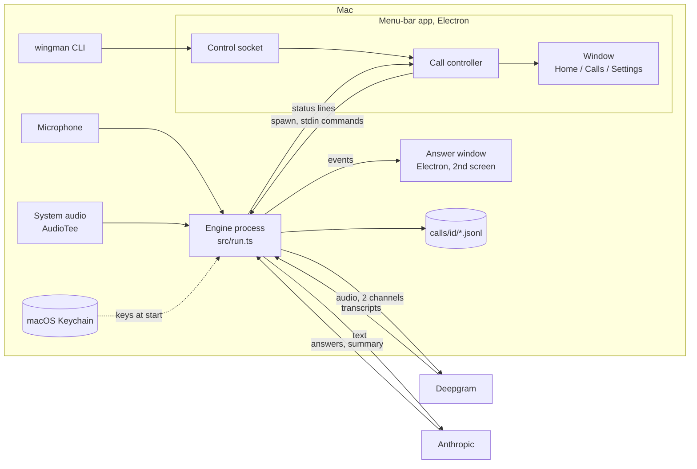

# Architecture

This document describes how Wingman is built today (the "Stage 0" app in `stage0/`). Where this document and the code differ, the code is right.

Contents: [Big picture](#big-picture) · [Components](#components) · [Processes and data flow](#processes-and-data-flow) · [Call lifecycle](#call-lifecycle-and-phases) · [Files on disk](#files-on-disk) · [Latency budget and cost model](#latency-budget-and-cost-model) · [Testing](#testing)

## Big picture

Wingman is one TypeScript engine (a Node process per call) plus an Electron host that starts, stops and shows it.

- The **engine** (`stage0/src/run.ts`) does everything during a call: audio in, speech to text, detection, answers, logging.
- The **menu-bar app** (`stage0/tray/`) is an Electron process. It owns one call controller, starts the engine as a child process, hosts the Home / Calls / Settings window and the control socket.
- The **answer window** (`stage0/overlay/`) is a second Electron process, started by the engine, shown on the second screen.
- The **CLI** (`wingman`) is a thin client of the control socket.

Everything is plain files. There is no database and no server.

## Components

### Engine (`stage0/src/`)

| Component | File | What it does |
|---|---|---|
| Call loop | `run.ts` | Wires all the parts below. Reads audio, handles each utterance, shows cards, writes logs, shuts down. Can replay a stereo WAV (`--file`) instead of live audio. Remote-controlled by the app through stdin commands and `@@wingman` status lines on stdout (`WINGMAN_CONTROL=1`). |
| Audio | `audio.ts`, `devices.ts`, `echo.ts` | System audio through AudioTee (Core Audio tap) is the "them" channel. The microphone through ffmpeg is the "me" channel. Optional "device" source (for example BlackHole). Speakers mode: a mic gate plus an echo text filter, so no headphones are needed. |
| Speech to text | `stt.ts`, `providers/stt/` | One streaming connection per channel. Deepgram Nova-3 is the default. Soniox and Gladia adapters exist but are experimental (tested against a mock server only). Keyterms, reconnect buffer (last 2 s replayed), fallback provider, circuit breaker, foreign-script filter. |
| Utterance handling | `split.ts`, `multiq.ts`, `normalize.ts` | Joins a question that was cut by a pause ("כמה זה" ... "עולה לחודש"), cuts several back-to-back questions into separate ones, and normalises Hebrew (niqqud, final letters, prefixes) for matching. |
| Question detector | `detector.ts` | Hebrew-aware rules that decide whether a "them" line is a question. Local, free, instant. Tested on a labelled corpus (`data/questions.tsv`). |
| Answer bank | `bank.ts`, pack `bank.yaml` | Keyword cards written by the user (title, triggers, a short "say" line, facts). Matching is local. Returns the best card or nothing. |
| Reflex | `reflex.ts`, `providers/llm.ts` | One streamed call to a small model. The first line is a tag: `SKIP`, `STALL`, `BANK <id>` or `ANS`; then the card text. A stall line is shown if there is no tag after `reflex.stallAfterMs`. The prompt prefix is cached (Anthropic prompt cache). |
| Guards | `guards.ts` | Code (regular expressions, not prompts) that blocks prices, dates, deadlines and promises in AI text, in Hebrew and English, including number words. A hit replaces the text with a stall line. |
| Calc | `calc.ts` | Local arithmetic for "For you" questions and to keep math away from the price stall line. |
| Assist | `assist.ts` | Answers questions the user asks out loud (`assist.answerMe`) or after the Ctrl+Opt+A key. Local cues first, then one tiny classifier call only if unsure. |
| Frame | `frame.ts` | About once a minute: what kind of call is this (client, support, vendor, team, consult, personal, other), topic, goal, people, and a checklist. The kind changes only after two updates agree. Feeds answers, tips and the summary. |
| Speakers and flow | `speakers.ts`, `flow.ts` | The speech provider tells the other side's voices apart (`stt.speakers`); `speakers.ts` gives them call-local numbers and names (from introductions, a prepared meeting's attendees, or `wingman speaker`). `flow.ts` notices when several of them talk among themselves (a muted line, answer cards wait) and when someone turns to the user (an alert). Setting `flow.enabled`. Nothing is kept across calls. |
| Interview mode | `brief.ts`, `run.ts` | A prepared meeting of kind `interview` switches to coaching: the plan's own cards (note `Prepared cards: <file.yaml>`) replace the bank, no Buy time lines, every question gets an answer built from the background notes. |
| Tips and notes | `tips.ts`, `notes.ts`, `brief.ts` | At most one small tip every two minutes (AI or local: "you talk more than 75 percent"). Live notes every 30 s. Must-cover reminders from the Plan. |
| Fact cards | `entities.ts`, `facts-check.ts` | Matches client and domain names in the call against a local snapshot (`data/private/entities.json`, git-ignored). No network lookup during a call. |
| Capture | `capture.ts` | Finds phone numbers, emails and domains, including spoken Hebrew digit words. |
| Summary | `summary.ts` | When a call ends: one model call over the saved transcript. Writes `summary.json` (summary, decisions, next steps, open questions, follow-up email draft). The email passes through the guards, so prices, dates and promises become `[להשלים: ...]`. |
| Health | `health.ts` | A supervisor that turns signals (STT lag, LLM errors, audio silence, cost) into the degrade ladder: full, reduced AI, provider switch, bank only, transcript only, off. |
| Cost | `cost.ts` | Counts spend from real usage reported by the providers and an editable price table. LLM spend is capped per call; speech spend is tracked and shown. |
| Settings | `settings.ts`, `settings-edit.ts`, `config/defaults.yaml` | Layered settings validated by a zod schema. Layers, lowest first: built-in defaults, `~/.config/wingman/settings.yaml`, a profile (`profiles/*.yaml`), `WINGMAN_*` environment variables, CLI flags. Unknown keys are errors. |
| Keys | `keychain.cjs`, `keychain.ts`, `keys-cli.ts`, `env.ts` | macOS Keychain access through `/usr/bin/security` (no shell). Keys live only in memory during a call. |
| Doctor | `doctor.ts`, `mic-check.ts` | The "Readiness check". Ends with READY, READY WITH WARNINGS or NOT READY. |
| Logging | `log.ts` | Writes the call folder (files are mode 600). |

### Menu-bar app (`stage0/tray/`)

- `main.cjs`: Electron main process. Tray icon and menu, global shortcuts, notifications, the single window.
- `controller.cjs`: the one call controller. Starts and stops the engine child process, tracks the call phase, rate-limits start/stop, handles Quit during a call. Unit-tested with a fake child process.
- `control-socket.cjs`: the local control socket (see below).
- `attachments.cjs`: background files for a Plan (`.txt`, `.md`, pasted text, `.pdf` only if `pdftotext` is already installed). One store per prepared meeting.
- `plans.cjs` and `../shared/plans.js`: the **prepared meetings** store and its pure rules. Several Plans can wait at once, each in `data/private/briefs/plans/<id>/` (`meeting.json`, `files/`, and `brief.yaml` written for the engine when a call starts). A meeting has an optional title and time. Expiry: a meeting with a time stays until 6 h after it, one without a time 14 days after its last edit, a used one is kept 7 days (so Calls can show which Plan a call used) and its background files are dropped when it is used. The single Plan of earlier versions (`latest.yaml` plus flat `attachments/`) becomes one meeting the first time the store is opened (`migrate()`, idempotent). A call starts either **quick** (the engine gets `--no-brief`, nothing is used up) or with **one chosen meeting** (`--brief <its brief.yaml>` and `WINGMAN_ATTACH_DIR=<its files>`); the controller marks that meeting used when the call goes live, never for a practice call.
- `settings-catalog.cjs`: the plain-words Settings page definitions (13 options and an Advanced list).

### Window (`stage0/dashboard/`)

A local-only HTML/JS UI (no framework, no network, strict Content-Security-Policy, sandboxed, no navigation). Pages: **Home** (readiness, Start with a Quick call and the Prepared meetings list, the Plan editor, what is waiting, live call panel), **Calls** (list, call review, ratings, summary and follow-up), **Settings** (including Keys). It talks to the main process through a preload bridge with an allow-list.

### Answer window (`stage0/overlay/`)

A frameless, always-on-top, non-focusable Electron window on the second screen (content protection is on, but untested with Zoom, so the second screen is the real protection). It shows the newest answer large, older answers small, health bars, the checklist, capture chips and the "what did they say" rewind sheet. It is started by the engine and receives events over IPC.

### Control socket and CLI

The app listens on `~/.config/wingman/run/control.sock` (directory mode 700, socket mode 600, owner check). Only a fixed list of commands is accepted. The CLI (`stage0/src/cli/`, `wingman` command, exit codes 0 to 9) sends commands such as `status`, `start` (`--quick`, or `--plan <id>` for a prepared meeting; plain `start` never guesses, see ADR 37), `stop`, `ask`, `note`, `plan` (list, new, set --id, attach, delete), `calls` and `settings`. It never starts a second engine, never prints keys, and destructive commands need `--yes`. It was built so that an AI coding agent can drive Wingman safely, with `--json` output on every command.

### Shared tokens (`stage0/shared/`)

`tokens.css` holds the design tokens (colours, fonts, spacing, dark and light) used by the window and the answer window. `ask.js` is shared UI logic for the ask countdown.

### Brand (`brand/`)

The capybara logo with a yuzu on its head, icons and the build script. `scripts/make-app.sh` copies the Electron runtime to `stage0/.app/Wingman.app`, renames it and adds a launcher that loads this repo's code, so the Dock and notifications say "Wingman".

## Processes and data flow



One utterance from the other side, step by step:

```
them audio -> Deepgram (interim + final text) -> join/split fragments
  -> detector: is it a question?   no -> only logged
  -> bank match (local)  -> Prepared card shown at once (dimmed if the call is not a client call)
  -> reflex (Haiku, streamed): SKIP | STALL | BANK id | ANS
        no tag in 1.8 s -> Buy time line shown, model keeps streaming
        ANS text -> guards -> card (or stall line if a guard hits)
  -> card rate limit (3 new cards a minute; price/timeline/guarantee stalls are exempt)
  -> answer window + cards.jsonl + events.jsonl
```

For lines from the user's own channel ("me"): echo filter, then `assist.ts` decides "is this for Wingman?", then the math evaluator or one model call answers into a "For you" card.

Background loops run beside this: call frame (every 60 s), live notes (every 30 s), tips (max one per 2 min), must-cover reminders, health supervisor (every 1 s), idle stop (15 min of silence).

## Call lifecycle and phases

`call.json` in the call folder and the app state carry a `phase`:

| Phase | Meaning |
|---|---|
| `starting` | The engine is booting: loading settings, keys, bank; opening the answer window and the audio. |
| `waiting` | Only if the optional setting "Ask me before listening starts" is on: the call waits for **Start listening** (Ctrl+Opt+Return). Nothing is sent to the cloud before that. |
| `live` | Listening. Audio streams to Deepgram. This is the normal state by default. |
| `ended` | The call is over and saved. |

While a call ends, a separate `stopPhase` shows the steps (`wingman status` prints it):

| stopPhase | Meaning |
|---|---|
| `saving` | Stopping audio, flushing logs, writing `call.json` (`endedAt`). |
| `summary` | Writing the summary with one model call (up to `summary.timeoutMs`, 20 s). You can **Skip summary**; the call is kept and the summary can be written later with `wingman calls summary <id> --generate`. |
| `done` | Finished. |

Other lifecycle rules: Stop and delete asks first (Cancel is the default); Quit during a call asks, and if you confirm it stops and saves the call first (up to 20 s); a stuck stop is forced off, mic included; the call stops itself after 15 minutes of silence; the Mac is kept awake with `caffeinate`; a sleep gap longer than 5 s shows a warning.

## Files on disk

Per call, in `stage0/calls/<ulid>/` (owner-only, umask 077; the folder is git-ignored; audio is never saved):

| File | Content |
|---|---|
| `call.json` | Metadata: id, start and end time, phase, kind, mode, settings summary. |
| `events.jsonl` | Everything that happened: detections, card decisions, guard hits, provider switches, health ladder changes, frame updates, tips, errors, speed summary. One JSON object per line, flushed per line, so a crash leaves a valid log. |
| `transcript.jsonl` | Final transcript lines with speaker (`me` or `them`) and time. |
| `cards.jsonl` | Every card shown (kind, text, source: bank, AI, stall, for you, fact, tip, note). |
| `latency.jsonl` | Speech end to bank card / tag / first words, per question. |
| `usage.jsonl` | Tokens and speech seconds, with USD from the price table. |
| `summary.json` | Written after the call (summary, decisions, next steps, open questions, follow-up email draft, guard counts, cost). |
| `tags.jsonl` | Your useful / not useful ratings of cards. |

Outside the call folders:

| Place | Content |
|---|---|
| macOS Keychain, service `wingman` | `DEEPGRAM_API_KEY`, `ANTHROPIC_API_KEY`. |
| `~/.config/wingman/settings.yaml` | Your personal settings (mode 600, comments kept). |
| `~/.config/wingman/keys.env` | Legacy keys file. Still read if present; Settings -> Keys can move it into the Keychain. |
| `~/.config/wingman/run/control.sock` | The control socket. |
| `stage0/calls/tray.log` | Menu-bar app log: status lines only, no call content. |
| `stage0/data/example-pack/` (`bank.yaml`, `house-style.md`, `keyterms.txt`) | The example pack: answer bank, tone rules and speech hints. Your own pack (`~/.config/wingman/pack/`) replaces it. |
| `~/.config/wingman/profile.yaml` | Your profile: name, spellings, how to address you, your business. Never in the repo. |
| `stage0/data/private/` | Git-ignored: client snapshot (`entities.json`), saved Plans and attachments (`briefs/`). |

## Latency budget and cost model

Measured numbers (from the project's own tests; a real Hebrew call with room noise is slower than the synthetic voice):

| Path | Typical |
|---|---|
| Question detected and a Prepared card shown | p50 about 0.6 s, p95 about 1.9 s after the speaker stops (includes speech-to-text final lag, about 0.4 s at `endpointMs: 200`) |
| Math for you | about 0.4 s |
| AI answer for you | about 1.7 s |
| AI answer for the other side | about 1.4 s |
| Haiku time to first tag | about 0.85 s in the readiness check |
| Buy time line | forced at 1.8 s if the model has not tagged |
| Stale answers | dropped if the question is older than 4 s |

Cost model (price table is in `config/defaults.yaml`, `budget.prices`, and is an **estimate: check your providers' price pages**):

| Item | Price used | Per hour of call |
|---|---|---|
| Deepgram Nova-3 | $0.55 per hour per channel, two channels | about $1.10 |
| Claude Haiku | $0.10 / $0.50 per million input / output tokens, cache read $0.01 | a few cents (frame, notes, tips and answers together; the project measured roughly $0.04 for a 10-card test call) |
| Summary | one call | about $0.002 to $0.005 |

Caps: `budget.maxUsdPerCall` (default $2) drops AI to bank-only when reached; `budget.maxMinutesPerCall` warns; `budget.maxUsdPerMonth` is checked by the readiness check. Speech spend is not capped, only tracked. Set spend limits in the Deepgram and Anthropic consoles too.

## Testing

| Layer | What | Run |
|---|---|---|
| Unit tests | About 355 tests in `stage0/src/*.test.ts` (node's test runner through tsx, run one file at a time): detector, bank, guards, calc, split, echo, settings, keys (mocked `security`), CLI, control socket, controller (fake child), dashboard security, overlay logic, health ladder, summary, frame, tips, and an offline end-to-end call with scripted speech and scripted AI. | `pnpm test` |
| Corpora | Detector precision/recall on `data/questions.tsv`; bank accuracy on 40 held-out utterances. | `pnpm detector`, `pnpm banktest` |
| STT gate | Scores Deepgram on your recording of 40 Hebrew sentences with English tech terms (term recall, endpoint-to-final lag). | `pnpm gate` |
| QA harness | `qa/scenarios/*.json` (31 invented call scripts) are rendered with macOS voices to stereo WAV (left = me, right = them, with pauses and overlaps), played in real time through the real engine with real Deepgram and real Haiku, and graded: question recall and precision, right card, price questions stall, split-question join, first-card time, STT word accuracy, summary present, guard leaks, cost. Output: `qa/report.md`. `--replay` re-plays what Deepgram heard for pennies; `--dry` only estimates cost; `--cap` sets a spend cap. | `pnpm qa --all` |
| Snapshot mode | Hidden-window screenshots of the real window and answer window with fake call states (`WINGMAN_DASHBOARD_SNAPSHOT`, `WINGMAN_DASHBOARD_FAKE_CALL`, `overlay/snapshot.sh`). Used for the UX audit and an automated check that every interactive element has hover, pressed and focus states. No tray, no shortcuts, no spawned call. | see [DEVELOPMENT.md](DEVELOPMENT.md) |
| Deep test | A one-off round (real Deepgram and Haiku, a 60-minute soak, failure injection, a 166-utterance answer-quality judge). Results are summarised in [ROADMAP.md](ROADMAP.md). | manual |

Limits of the tests: synthetic voices are cleaner than real people, so speech accuracy and detection are optimistic; "talking over each other" is two clean signals added together; the Electron click paths and macOS permission prompts are only partly automated.
