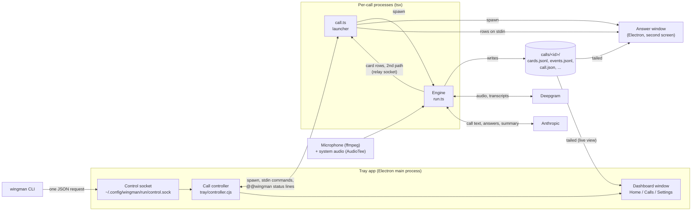

# Architecture

For developers and reviewers who want to know how Wingman is built today (the app in `app/`). Where this document and the code differ, the code is right. To run something first, see [Getting started](GETTING-STARTED.md); for the reasons behind the choices, see [DECISIONS.md](DECISIONS.md).

Contents: [Big picture](#big-picture) · [Process diagram](#process-diagram) · [Components](#components) · [Processes and data flow](#processes-and-data-flow) · [Call lifecycle](#call-lifecycle-and-phases) · [Files on disk](#files-on-disk) · [Latency budget and cost model](#latency-budget-and-cost-model) · [Testing](#testing)

## Big picture

Wingman is one TypeScript engine (a Node process per call) plus an Electron host that starts, stops and shows it.

- The **engine** (`app/src/run.ts`) does everything during a call: audio in, speech to text, detection, answers, logging.
- The **menu-bar app** (`app/tray/`) is an Electron process. It owns one call controller, starts the engine as a child process, hosts the Home / Calls / Settings window and the control socket.
- The **answer window** (`app/overlay/`) is a second Electron process, started by `call.ts`, shown on the second screen.
- The **CLI** (`wingman`) is a thin client of the control socket.

**Why TypeScript and plain JavaScript are both here.** The engine and CLI are TypeScript (strict, run through `tsx`). The Electron main process (`tray/`), the window (`dashboard/`) and the answer window (`overlay/`) are CommonJS and classic browser scripts on purpose: Electron loads CommonJS main-process code with no build step, and the renderers run under a strict Content-Security-Policy as plain scripts, with no bundler and no `eval`. Code both sides need (`shared/`) is written once as a small UMD module. The cost is less type checking in that glue code, which the unit and snapshot tests cover. The plan is to type-check these files with `checkJs` and JSDoc types as they are touched, rather than adding a build step. See [ADR 25](DECISIONS.md#adr-25-an-electron-menu-bar-app) for the app decision.

Everything is plain files. There is no database and no server.

## Process diagram



The tray app starts one call at a time through the controller, which runs `call.ts`. `call.ts` starts the engine (`run.ts`) and the answer window. The window reads the call folder itself; the relay socket is only a backup path for card rows if writing `cards.jsonl` fails. Keys come from the macOS Keychain at start and live only in memory.

## Components

### Engine (`app/src/`)

| Component | File | What it does |
|---|---|---|
| Call loop | `run.ts` | Wires all the parts below. Reads audio, handles each utterance, shows cards, writes logs, shuts down. Can replay a stereo WAV (`--file`) instead of live audio. Remote-controlled by the app through stdin commands and `@@wingman` status lines on stdout (`WINGMAN_CONTROL=1`). |
| Audio | `audio.ts`, `devices.ts`, `echo.ts` | System audio through AudioTee (Core Audio tap) is the "them" channel. The microphone through ffmpeg is the "me" channel. Optional "device" source (for example BlackHole). Speakers mode: a mic gate plus an echo text filter, so no headphones are needed. Each source runs under a supervisor (`SupervisedSource`): if it exits, hangs or its device vanishes it restarts with a backoff (1, 2, 4 s, then every 10 s). `pickMicDevice` falls back to the default mic when the chosen one is gone. A source that cannot start is not fatal: the call goes on with the other one. |
| Provider catalog | `providers/catalog.ts` | The one place that names every speech and AI provider and its key variable. Settings schema, key names and types follow from it, and the compiler fails if a registry (`STT_PROVIDERS`, `LLM_PROVIDERS`) and the catalog disagree. |
| Audio platform | `audio-platform.ts`, `engine/audio-sources.ts` | `AudioBackend` (a mic source and a system-audio source) and `AudioSource` (start, stop, frames) hide the OS. The macOS backend is the AudioTee + ffmpeg code described above; win32 and linux are stubs with TODO notes. Device listing is not behind the backend yet. |
| Diagnose | `cli/diagnose.ts` | `wingman diagnose [call id|latest] [--out file]` writes one file for a bug report: versions, changed settings, health, ladder and error events, device names, model and prompt ids, counts. No transcript or card text. Every card carries its model id and prompt id. |
| Pack drafting | `packgen.ts`, `cli/pack-cmd.ts` | `wingman pack from-notes <file.txt|.md|.pdf>` drafts bank cards from your own notes with one model call. Every draft card goes through `guard()`: a card that states a price, a date or a promise becomes a stall (its triggers move to `stall-price`, `stall-timeline` or `stall-guarantee`) and the report says so. The output is a draft folder; nothing is written into the live pack. See [ADR 42](DECISIONS.md#adr-42-pack-drafts-from-notes-pass-the-guards-and-never-touch-the-live-pack). |
| Speech to text | `providers/stt/` | One streaming connection per channel. Deepgram Nova-3 is the default. Soniox and Gladia adapters exist but are experimental (tested against a mock server only). Keyterms, reconnect buffer (last 2 s replayed), fallback provider, circuit breaker, foreign-script filter. |
| Utterance handling | `split.ts`, `multiq.ts`, `normalize.ts` | Joins a question that was cut by a pause ("כמה זה" ... "עולה לחודש"), cuts several back-to-back questions into separate ones, and normalises Hebrew (niqqud, final letters, prefixes) for matching. |
| Question detector | `detector.ts` | Rules for English, Hebrew and mixed speech that decide whether a "them" line is a question. Local, free, instant. Tested on a labelled corpus (`data/questions.tsv`). |
| Languages | `lang/` (`he.ts`, `en.ts`, `shared.ts`, `types.ts`, `index.ts`) | One `Language` module per spoken language: question heads and cues, request cues, fillers, number words, and the price, date, promise and salary patterns the guards use. The type has no optional fields, so a language cannot compile without its guard patterns. `detector.ts` and `guards.ts` read the active modules; the eval numbers are byte-identical to the pre-module code. About 700 Hebrew lines (for example normalisation and some fact-card words) still live outside `lang/`. See [ADR 38](DECISIONS.md#adr-38-one-module-per-language-and-a-call-language). |
| Call language | `calllang.ts` | `callLanguage(text, sttLanguage)` returns `he` or `en` for the helper-model prompts (summary, notes, tips, frame, topic, self-check). `stt.language: en` means English; otherwise the share of Hebrew letters in the call text decides (25 percent or more is Hebrew). No text, or too little to judge, stays Hebrew, so a Hebrew call never changes. |
| Answer bank | `bank.ts`, pack `bank.yaml` | Keyword cards written by the user (title, triggers, a short "say" line, facts). Matching is local. Returns the best card or nothing. |
| Reflex | `reflex.ts`, `providers/llm.ts` | One streamed call to a small model. The first line is a tag: `SKIP`, `STALL`, `BANK <id>` or `ANS`; then the card text. A stall line is shown if there is no tag after `reflex.stallAfterMs`. The prompt prefix is cached (Anthropic prompt cache). |
| Guards | `guards.ts` | Code (regular expressions, not prompts) that blocks prices, dates, deadlines and promises in AI text, in Hebrew and English, including number words. A hit replaces the text with a stall line. |
| Calc | `calc.ts` | Local arithmetic for "For you" questions and to keep math away from the price stall line. |
| Assist | `assist.ts` | Answers questions the user asks out loud (`assist.answerMe`) or after the Ctrl+Opt+A key. Local cues first, then one tiny classifier call only if unsure. |
| Frame | `frame.ts` | Since round 12 (r3) it has no model call. The call memory (`session/`) learns what a call is about, and the call kinds are listed once in `session/types.ts`. What stays in `frame.ts` is pure: the `Frame` shape that tips, the summary and old call folders still read, its parser and stability rules, and `isAgencyTopic(text, kind)`, which takes the kind from its caller (no module-level state). |
| Speakers and flow | `speakers.ts`, `flow.ts` | The speech provider tells the other side's voices apart (`stt.speakers`); `speakers.ts` gives them call-local numbers and names (from introductions, a prepared meeting's attendees, or `wingman speaker`). `flow.ts` (`FlowTracker`) notices when several of them talk among themselves (a muted line, answer cards wait) and when someone turns to the user (an alert). Setting `flow.enabled`. Renaming a voice relabels the earlier lines. Nothing is kept across calls. |
| Practice and mock-interview mode (kind `interview`) | `brief.ts`, `run.ts`, `guards.ts` | A prepared meeting of kind `interview` switches to practice coaching: a mock interview with suggested answers in your own words, built from your own notes. Not for live use in a real interview. The meeting's own cards (note `Prepared cards: <file.yaml>`, bank format, one file per meeting) replace the bank. No Buy time lines, no card limit, every question gets an answer built from the background notes. The guard blocks only a salary figure (`guardInterview`). No fact cards and no self-check cards. Tips follow the normal settings. |
| Tips and notes | `tips.ts`, `notes.ts`, `brief.ts` | At most one small tip every two minutes (AI or local: "you talk more than 75 percent"). Live notes every 30 s. Must-cover reminders from the Plan. |
| Fact cards | `entities.ts`, `facts-check.ts` | Matches client and domain names in the call against a local snapshot (`entities.json` in the data folder). No network lookup during a call. Off in practice and prep mode. |
| Capture | `capture.ts` | Finds phone numbers, emails and domains, including spoken Hebrew digit words. |
| Summary | `summary.ts` | When a call ends: one model call over the saved transcript. Writes `summary.json` (summary, decisions, next steps, open questions, follow-up email draft). The email passes through the guards, so prices, dates and promises become `[להשלים: ...]`. |
| Reliability rules | `audio.ts`, `engine/shutdown.ts`, `engine/strays.ts`, `engine/control.ts`, `providers/stt/channel.ts` | Every spawned audio source is watched, also while down. Stop writes `endedAt` and phase `ended` first. Stray errors are logged, never fatal before the 16 s guard. The stdin reader starts first; `stop` runs at once. STT events are wired before the sockets open. The STT channel goes back to the primary after 60 s. Speaker numbers restart per STT connection (`SpeakerBook.rebase`). One shutdown deadline (`engine/shutdown-deadline.ts`) is counted from the start of shutdown. See ADR 50. |
| Health | `health.ts` | A supervisor that turns signals (STT lag, LLM errors, audio silence, cost) into the degrade ladder: full, reduced AI (the AI is slow: answers keep coming and a late one is dropped), provider switch, bank only, transcript only, off. A dead speech channel for the other side is "transcript only" (rung 4) and is retried slowly, never "off". "Off" is only for a user stop. |
| Resilience | `run.ts`, `clock.ts`, `diskspace.ts`, `errtext.ts` | Core handlers (`onResult`, `acceptResult`, `flush`, `onQuestion`, `handleMe`) are wrapped: an error is logged as `error.survived` and the call goes on (repeated errors still end it). `clock.ts` tells a sleep from a clock change by comparing wall time with the monotonic clock; after wake the idle timer starts again, both audio sources are rebuilt and the speech sockets reopen. `diskspace.ts` checks free space on the data folder (amber under 500 MB, red under 100 MB). `errtext.ts` turns an error into one safe line (raw error objects can contain prompts). |
| Answer-window relay | `relay.ts`, `call.ts` | A second path from the engine to the answer window, used if writing `cards.jsonl` fails (disk full). The engine writes each cards row to a private unix socket in a 0700 temp folder. `call.ts` forwards the rows to the window, which drops duplicates, and keeps the last rows for a window that restarts. |
| Profile and pack | `profile.ts`, `pack.ts` | The profile (`~/.config/wingman/profile.yaml`) is validated by a strict schema, including the time zone. A bad edit during a call keeps the last good profile; the file is saved atomically. The pack looks up each file in `WINGMAN_PACK_DIR` or `~/.config/wingman/pack/`, then in `data/example-pack/`. Starter packs (sales, support, interview practice, empty; Hebrew and English) live in `data/starter-packs/` and the setup copies one into your pack folder. See [PACK-FORMAT.md](PACK-FORMAT.md). |
| Cost | `cost.ts` | Counts spend from real usage reported by the providers and an editable price table. LLM spend is capped per call; speech spend is tracked and shown. |
| Settings | `settings.ts`, `settings-edit.ts`, `config/defaults.yaml` | Layered settings validated by a zod schema. Layers, lowest first: built-in defaults, `~/.config/wingman/settings.yaml`, a profile (`profiles/*.yaml`), `WINGMAN_*` environment variables, CLI flags. Unknown keys are errors. |
| Keys | `keychain.cjs`, `keychain.ts`, `keys-cli.ts`, `env.ts` | macOS Keychain access through `/usr/bin/security` (no shell). Keys live only in memory during a call. |
| Doctor | `doctor.ts`, `mic-check.ts` | The "Readiness check". Ends with READY, READY WITH WARNINGS or NOT READY. |
| Logging | `log.ts` | Writes the call folder (files are mode 600). |
| Data paths | `env.ts`, `../shared/paths.cjs`, `../shared/migrate.cjs` | One module decides where user data lives (the data folder). `migrate.cjs` copies the old in-repo folders once (never moves, never overwrites, writes a marker). |

### Menu-bar app (`app/tray/`)

- `main.cjs`: Electron main process. Tray icon and menu, global shortcuts, notifications, the single window.
- `controller.cjs`: the one call controller. Starts and stops the engine child process, tracks the call phase, rate-limits start/stop, handles Quit during a call. Unit-tested with a fake child process.
- `control-socket.cjs`: the local control socket (see below).
- `attachments.cjs`: background files for a Plan (`.txt`, `.md`, pasted text, `.pdf` only if `pdftotext` is already installed). One store per prepared meeting.
- `plans.cjs` and `../shared/plans.js`: the **prepared meetings** store and its pure rules. Several Plans can wait at once, each in `<data folder>/briefs/plans/<id>/` (`meeting.json`, `files/`, and `brief.yaml` written for the engine when a call starts). A meeting has an optional title and time. Expiry: a meeting with a time stays until 6 h after it, one without a time 14 days after its last edit, a used one is kept 7 days (so Calls can show which Plan a call used) and its background files are dropped when it is used. The single Plan of earlier versions (`latest.yaml` plus flat `attachments/`) becomes one meeting the first time the store is opened (`migrate()`, idempotent). A call starts either **quick** (the engine gets `--no-brief`, nothing is used up) or with **one chosen meeting** (`--brief <its brief.yaml>` and `WINGMAN_ATTACH_DIR=<its files>`); the controller marks that meeting used when the call goes live, never for a practice call.
- `settings-catalog.cjs`: the plain-words Settings page definitions (29 options in 6 groups, and an Advanced list).

### Window (`app/dashboard/`)

A local-only HTML/JS UI (no framework, no network, strict Content-Security-Policy, sandboxed, no navigation). Pages: **Home** (readiness, Start with a Quick call and the Prepared meetings list, the Plan editor, what is waiting, live call panel), **Calls** (list, call review, ratings, summary and follow-up), **Settings** (including Keys, About you and the Setup guide). The first time, Home shows the guided setup (`setup.js`, `setup-ipc.cjs`): three required steps (Try it, Connect, Allow), then optional items (About you, privacy, microphone, starter answers, readiness check). The step list and progress rules are in `setuplib.js`. System Audio Recording has no live status in macOS, so the guide asks you to confirm and restart. It talks to the main process through a preload bridge with an allow-list.

### Answer window (`app/overlay/`)

A frameless, always-on-top, non-focusable Electron window on the second screen (content protection is on, but untested with Zoom, so the second screen is the real protection). The default **Focus layout** (`overlay.layout: focus`) shows the other side's last line, one big answer and a bar with three main keys (Ask Wingman, More, Pause); a **More** panel (Ctrl+Opt+L) holds the checklist, the client card, notes and captured details. `overlay.layout: full` shows every card and panel at once, with older answers small. Health bars, capture chips and the "what did they say" rewind sheet work in both. **Card model (v3).** `overlay/v2.js` is the pure model (no DOM): the hero seat, chips, stale and collapse rules (3 and 6 minutes; checks, facts and pinned cards never collapse), ratings (`useful`, `not_useful`, `fewer`), the key map and the rule for what a screen reader hears. `v2view.js` only draws it and keeps the keyboard focus across redraws. `act.cjs` writes `tags.jsonl` rows for ratings (`fewer` gives `useful: "n"`) and `overlay-events.jsonl` rows for pin, dismiss and recap. The count of cards shown in the app's life is `overlay-state.json` in the data folder (owner-only), written by `main.cjs`; snapshots never touch it. On exit the orphan guard (`makeBye` in `lib.cjs`) clears every timer and the display listeners. It is started by `call.ts` (the per-call launcher). It reads the call's `cards.jsonl` and also receives rows over the relay socket (see above). Its script is an external file (`app.js`) under a strict Content-Security-Policy; the preload bridge is a fixed list, navigation and `window.open` are blocked, and if the window process crashes it reloads. With one screen it stays closed unless `overlay.allowPrimary` is on.

### Control socket and CLI

The app listens on `~/.config/wingman/run/control.sock` (directory mode 700, socket mode 600, owner check). Only a fixed list of commands is accepted. The CLI (`app/src/cli/`, `wingman` command, exit codes 0 to 9) sends commands such as `status`, `start` (`--quick`, or `--plan <id>` for a prepared meeting; plain `start` never guesses, see ADR 37), `stop`, `ask`, `note`, `plan` (list, new, set --id, attach, delete), `calls` and `settings`, plus `diagnose` and `pack from-notes` (these two run without the app). It never starts a second engine, never prints keys, and destructive commands need `--yes`. A real start from the CLI asks the user in a window in the app (`privacy.askBeforeCliStart`), and `stop --delete` always asks. `wingman update` and `wingman uninstall` are handled by `install.sh` and need no running app. It was built so that an AI coding agent can drive Wingman safely, with `--json` output on every command.

### Shared tokens (`app/shared/`)

`tokens.css` holds the design tokens (colours, fonts, spacing, dark and light) used by the window and the answer window. `ask.js` is shared UI logic for the ask countdown.

### Brand (`brand/`)

The capybara logo with a yuzu on its head, icons and the build script. `scripts/make-app.sh` copies the Electron runtime to `app/.app/Wingman.app`, renames it, turns off three Electron fuses (`scripts/set-fuses.cjs`) and adds a launcher that loads this repo's code, so the Dock and notifications say "Wingman". `install.sh` at the repo root checks the machine, installs, builds the app and can copy it to `/Applications` (see [DEVELOPMENT.md](DEVELOPMENT.md#install-update-uninstall)). **Packaged app.** `pnpm dist` (`scripts/package-app.cjs`, `electron-builder.cjs`) bundles the engine with esbuild into `src/*.mjs` and builds a self-contained `Wingman.app` and `.dmg` that needs no Node, pnpm or checkout. The app starts its own executable for each tool (`Wingman --wingman-tool <name>`, `Wingman --wingman-overlay`; allow-list in `shared/bin.cjs`, `tray/app-entry.cjs`). There is no asar, because the engine starts child processes and the audiotee binary from the app folder; the `RunAsNode` fuse stays off. Builds are ad hoc signed, not notarised; the release workflow has not run yet. The `wingman` command line is still a dev-checkout feature. See [DEVELOPMENT.md](DEVELOPMENT.md#building-the-app-dmg) and [ADR 40](DECISIONS.md#adr-40-a-self-contained-unsigned-app-bundle).

## Moment core (round 12)

`app/src/moments/` holds the decision pieces for the new "moment" engine. They are pure: no globals, no network, a clock is passed in.

- `parse.ts` reads the model reply. Line 1 is the verdict (`SKIP`, `ANS`, `BANK <id>`, `STALL`, `REPLY`, `CHECK`, `TERM`, `PROMPT`, `NOTE`), then `VALUE`, `AIM`, `SAY` (14 words at most), `WHY`, `MORE`, `REF`. The verdict is known as soon as line 1 ends. Anything wrong becomes `SKIP` plus an `error.survived` row. It never throws.
- `intake.ts` drops only structural noise (under 2 tokens, echo, a repeat within 3 s, very low confidence). It never drops a line with a digit or a currency sign, or a line of 2+ tokens ending in `?`. It also gives `TurnFeatures`. It has no word lists.
- `hint.ts` wraps the old detector as `strong | weak | none`. It is frozen. It only sets how fast the model is asked, and it is the offline gate.
- `observer.ts` decides when to call the model: strong hint at once, weak hint after 0.7 s quiet, 12 new words, topic change, user ask. At most 6 calls a minute; held lines go into the next window.
- `scheduler.ts` decides `show | chip | drop` from VALUE, AIM, novelty, rank, topic lifetime, a per-minute cap (price and guarantee stalls and checks are exempt), feedback and the turn id.
- `prompt.ts` is the moment instruction text. The call language, roster and top 3 bank candidates are data.

The bank (`bank.ts`, `bank-score.ts`) matches in this order: exact trigger, then a local BM25 over character 3-grams of title, triggers and say line, else the top 3 cards go to the model. The language of a turn is passed as an argument.

### Moment engine in the live call (`moments.engine: v2`)

The setting `moments.engine` picks the path for a call. `v2` (the default, shown as Live reading) lets the model decide; `legacy` (Classic, the rollback) runs the old gate and reflex call unchanged. `v2` is off in a practice interview and with `--no-ai`.

For every final line from the other side (`engine/ingest.ts`): intake drops noise, the frozen detector gives a hint (`strong`, `weak`, `none`), and `rules.ts momentRoute` picks the route.

| Route | When | What happens |
|---|---|---|
| direct | strong hint | The old question path runs (`engine/question.ts`): the bank or calc card shows at once, the stall timer runs (1.8 s). The model call is a `moment` call (`moments/run.ts`), not a reflex call. |
| observer | weak hint, no hint but 6+ words or a figure | The line waits in the observer window (`moments/observer.ts`). A due window is one `observer` call (`engine/moments.ts`). At most `moments.observerPerMinute` (6) a minute. |
| local | the AI is paused | No model call. Bank, calc and the stall line only. |
| drop | slow model (rung 1), observer off, observer shed by the hourly cap | The line is only context. |

Both calls use `buildContext` (the call memory, the newest transcript lines, the bank candidates), the extended tag set (`ANS BANK STALL REPLY CHECK TERM PROMPT NOTE`) and the scheduler. A card shows when VALUE is high enough, AIM is not `other`, and the point is new. ANS and REPLY pass the price, date and promise guards. The model card replaces a local card only if it is not SKIP and not the same bank id. A stall-tier card (price, timeline, guarantee) is never replaced by an answer.

Safety: a stream carries the id of its turn. A reply from a question that a newer final replaced cannot show a card. The parts of one final share one cancel scope and one turn id. A hang, a 5xx or 429, a refusal, garbage or a cut-off reply on a direct question ends in the stall line (when `reflex.stall` is on) within `reflex.stallAfterMs`. Every SKIP and every drop is logged with its reason and turn id (`moment.skip`, `moment.drop`, `moment.chip`, `moment.invalid`).

Over-promise check (`engine/side.ts checkOwnLine`): numbers the user says (digits, currency signs, the word after a number) are paired with numbers in the prepared notes and the call memory by unit and a shared word. A mismatch gives one Check card. A few currency words and short forms (shekel, dollar, euro) count as their sign. No model call.

Cost: usage rows carry the roles `moment` and `observer` and the context record (`ctx`). `CostMeter` keeps a rolling hour. At `budget.maxLlmUsdPerHour` the cheapest jobs stop first: compaction at 60 percent, observer at 80, memory at 90, direct questions last at 100 (the AI is paused). The per-call cap works as before.

Degrade (rung names are unchanged): a slow model means only strong hints call the model and the observer is off. A model that is down, a cap that is hit or no network means the old detector, bank, calc and stall line, plus one calm bar "AI paused" with the reason. The call memory stays as it was.

Tests: `src/moments-engine.test.ts` runs the real engine modules in the test process on the virtual clock and the policy fake (`testkit/engine-inproc.ts`). `src/moments-golden.test.ts` plays the dev golden meetings with their scripted replies and checks cost per role. `src/e2e/moments-v2.test.ts` runs the real process.

### Round 3 changes in the engine (round 12)

- **Floor and hint.** With the AI paused, `moments/floor.ts` decides from language-neutral signals (the speech-to-text "?", digits and money, a stall-tier card, a bank score, your name, the shape of a short sentence). The old detector is a tiebreak hint only ([ADR 56](DECISIONS.md#adr-56-live-reading-is-the-default-word-lists-are-a-hint-and-the-offline-floor)).
- **Precision.** The scheduler turns a `conf: low` or VALUE 1 card into a chip. `moments/learn.ts` keeps per-kind counts in `learn.json` and raises a bar by 1 after 3 negative ratings on 2 calls. `parse.ts` cuts at a clause end and sets `fit: false` ([ADR 57](DECISIONS.md#adr-57-precision-first-doubtful-cards-become-chips-labels-are-required-and-wingman-learns-from-ratings), [58](DECISIONS.md#adr-58-a-card-is-short-by-construction-not-cut-afterwards)).
- **Speech channels.** `speakers.ts` keys raw ids by `(epoch, raw)`, and `engine/stt.ts` rebases on reconnect, switch, failback and reopen ([ADR 59](DECISIONS.md#adr-59-speaker-numbers-belong-to-one-connection-an-epoch)). `SttChannel.send` rings audio whenever the socket is not open, also before the first open. Soniox flushes pending finals on reopen. A stream that opts in (`rxLiveness`, Deepgram) and hears nothing for 20 s while audio is sent is reopened ([ADR 67](DECISIONS.md#adr-67-a-socket-that-hears-nothing-is-dead-and-readers-use-call-wide-indexes)). Readers of the capped call transcript keep a call-wide cursor (`absLength`, `lineAt`), so the memory loop keeps reading after a long call drops its middle lines.
- **Early start.** `engine/ingest.ts` can start the direct path on a stable partial (`moments.earlyStart`, off; [ADR 60](DECISIONS.md#adr-60-early-start-on-a-stable-partial-off-until-the-latency-is-recorded)).
- **Shutdown and audio start.** One last-resort deadline counted from the start of shutdown (`engine/shutdown-deadline.ts`), a mic watch that starts after the mic does (`engine/mic-watch.ts`), parallel source starts with an 8 s timeout (`engine/start-sources.ts`), per-call maps and the transcript capped (`engine/capped.ts`).
- **Menu-bar app.** All dialogs are async. On quit, an engine asked to stop more than 3 s ago and still alive gets a synchronous SIGKILL to its process group.
- **Evidence.** `qa/ship.json` and `pnpm eval --ship` (absolute lines), the split `test-c`, `pnpm morning` and the recorded baseline ([ADR 61](DECISIONS.md#adr-61-ship-thresholds-are-absolute-and-the-final-read-uses-a-split-nobody-tuned-on), [62](DECISIONS.md#adr-62-scripted-is-not-recorded-every-number-is-labelled-and-release-needs-the-recorded-run), [Morning kit](MORNING-KIT.md)).
- **Second wave (shipped).** One memory: the Frame row above loses its own model call and the paused-AI ask path reads the SessionMemory plus a local tail ([ADR 63](DECISIONS.md#adr-63-one-memory-the-call-frame-is-retired)); modes can be locked and written by the user ([ADR 64](DECISIONS.md#adr-64-modes-are-visible-lockable-and-writable-by-the-user)).

### Call memory, wake hints and the prompt cache (round 12)

The memory loop (`engine/memory.ts`) learns from both sides of the call. It wakes the updater on hints that need no word list and no capital letters, so Hebrew and English behave the same: a digit, a question mark from the speech-to-text, a very long line, the end of a speaker turn when the source knows it, a pause after long speech, a question that stays open for 20 s, and a word that is new to the call right after the speaker changed (not on the roster, never heard before). The hints only wake the model; what a line means is the model's job. The unit word list in `claims.ts` is used only in practice interviews and by the old engine (`deps.localNumbers`).

At Stop the loop makes one last updater run (`finalPass`) so the last seconds are in the wrap-up. It has its own role in the gate (`memoryGate`): it is allowed while the call is closing, and it still respects consent, the cost cap, a model that is down and a call that is thrown away. When the topic label changes from one label to another, the loop calls `topicChanged()` and the observer looks at the call at once. Ratings in `tags.jsonl` reach the moment engine through `applyFeedback()`. A list that is nearly full wakes the compactor, because its oldest items are dropped next and the summary is where they live on.

Prompt cache. The provider caches a prompt prefix only above a model minimum: 512 tokens for Haiku 5.5, Sonnet 5.5 and Opus 5.x, 1024 for Sonnet 5 and the 4.x Sonnets, 2048 for Opus 4.7, 4096 for Haiku 4.5 and Opus 4.5 and 4.6 (`context/cache.ts cacheMinTokens`, checked against the Anthropic docs on 2026-11-08). A write costs 1.25 times (5 min) or 2 times (1 h) the input price, a read 0.1 times. So a marker pays only for a block that is read again before it expires. `buildContext` orders the system blocks by how often they change: shared block A (1 h), the role's fixed rules (1 h for moment, observer, memory, compact), the memory block (5 min, only moment and observer: the memory role writes a new one with every patch), the per-call facts (never cached), then the user message. `CACHE_POLICY` has the table and the reason for each entry. The older order (A, memory for every role, rules and facts last with no marker) left about 700 tokens of fixed rules unmarked on every moment and observer call. On the golden dev fixtures with the simulated provider cache, cost per hour fell from $0.061 to $0.050 (moment calls 40 percent cheaper, observer 35). A cached tail of the transcript (`tailChunk`, chunks cut at content-defined anchors, so the older chunks keep their bytes while the window grows) is built and tested but off: the memory block sits before it and changes every patch, so a cached tail would almost never be read.

Every usage row now carries `input_tokens`, `output_tokens`, `cache_read` and `cache_write` next to the raw `usage`, and, when the call has a context record, `est_tokens` and `drift_pct` (our estimate against the provider's count). A role that is off by more than 25 percent is logged once in a while as `tokens.drift`. `wingman doctor` prints a cache report for the last 5 calls (per role: calls, input, share read, share written, estimate drift) and says when a role is under the model's cache minimum or writes much and reads little.

Memory quality is measured, not assumed. `qa/memory-eval.ts` plays 12 labelled calls (6 English, 6 Hebrew, `data/memory-eval/`) through the real memory loop and scores the final memory per class (promises with their owner, open questions, numbers with their owner, decisions). A null control (nothing written) and a copy-all control (every line in every class) must stay under their limits. `pnpm eval:memory` runs it offline with the policy fake; with `WINGMAN_LLM_MODE=replay` it reads a cassette, and the owner can record one.

### Context, modes and the second memory (round 12, r3)

One memory. `frame.ts` lost its model call, its own kind list and `trackedKind`; the answer-bank gates read `chosenKind(st.m.mem)` (`session/types.ts`): the kind only when the user chose it (`kindLocked`). The model's guess is shown as a guess and does not switch the prepared bank off. `claims.ts`, `entities.ts` and the keyword helpers of `brief.ts` are fenced in their headers: interview mode and the legacy engine only. The question path without a memory loop (AI paused, legacy) sends the rendered call memory and `localTail()` (`engine/tail.ts`, newest lines up to a token budget) instead of the last 12 lines.

Names. `engine/memory.ts` replaces a word that is new to the call after a speaker change by the roster name it is close to (`context/names.ts`: edit distance with a Hebrew letter fold, no word list). A word close to nobody wakes the updater once and travels with the roster list; each word is asked about once.

Compaction safety. After a compaction patch, `session/safety.ts` finds open questions, open promises and unhandled objections that are gone, puts them back (new items give way first if a list is at its cap) and logs `compact.lost`. No model call.

Trim order (`context/build.ts TRIM_STEPS`): chunks after the best one, the oldest raw lines, memory down to its floor (its summary detail goes before any exact item), the best chunk, memory to nothing, role text, trigger, block A. The card's `ctx` record also lists `sources` (chunk id and file name), `trimmed` and `chars` (the input of the token calibration, `context/calibration.ts`).

Measuring. `cost.ts cacheReport()` gives input, cache read, cache write, hit share and USD an hour per role from usage rows; `blockAReport()` says whether block A reaches the model's cache minimum alone, only with the role rules, or not at all. `wingman doctor` prints both. A fixture run is labelled simulated. The tail cache (`tailChunk`) stays 0 for every role: `src/e2e/r3-context-modes-cache.test.ts` runs the golden dev calls with and without it on the simulated cache and checks that a role has it on only when the simulation gains more than 10 percent.

Modes. `SessionMemory.kindLocked` (the user chose; a model patch cannot change the kind), `modeId` (a custom mode from the pack `modes.yaml`, see PACK-FORMAT). `setMode()` in `session/patch.ts` is the one function that changes them; the control command `mode <kind|id|auto>` (stdin line, tray controller, control socket allowlist) calls it through `setCallMode()` in `engine/coach.ts`. `moments/modes.ts` adds the custom text and numbers on top of the built-in kind while a custom mode is active.

## Processes and data flow

The process diagram is at the top of this document ([Process diagram](#process-diagram)).

One utterance from the other side, step by step:

```
them audio -> Deepgram (interim + final text) -> join/split fragments
  -> detector: is it a question?   no -> only logged
  -> bank match (local)  -> Prepared card shown at once (dimmed if the call is not a client call)
  -> reflex (Haiku, streamed): SKIP | STALL | BANK id | ANS
        no tag in 1.8 s -> Buy time line shown, model keeps streaming
        ANS text -> guards -> card (or stall line if a guard hits)
  -> card rate limit (3 new cards a minute; price/timeline/guarantee stalls are exempt)
  -> answer window + cards.jsonl + events.jsonl
```

For lines from the user's own channel ("me"): echo filter, then `assist.ts` decides "is this for Wingman?", then the math evaluator or one model call answers into a "For you" card.

Background loops run beside this: live notes (every 30 s), tips (max one per 2 min), must-cover reminders, health supervisor (every 1 s), idle stop (15 min of silence).

## Call lifecycle and phases

`call.json` in the call folder and the app state carry a `phase`:

| Phase | Meaning |
|---|---|
| `starting` | The engine is booting: loading settings, keys, bank; opening the answer window and the audio. |
| `waiting` | Only if the optional setting "Ask me before listening starts" is on: the call waits for **Start listening** (Ctrl+Opt+Return). Nothing is sent to the cloud before that. |
| `live` | Listening. Audio streams to Deepgram. This is the normal state by default. |
| `ended` | The call is over and saved. |

While a call ends, a separate `stopPhase` shows the steps (`wingman status` prints it):

| stopPhase | Meaning |
|---|---|
| `saving` | Stopping audio, flushing logs, writing `call.json` (`endedAt`). |
| `summary` | Writing the summary with one model call (up to `summary.timeoutMs`, 20 s). You can **Skip summary**; the call is kept and the summary can be written later with `wingman calls summary <id> --generate`. |
| `done` | Finished. |

Failures and time limits: every speech-to-text open or reopen gives up after 8 s (`STT_OPEN_TIMEOUT_MS`, one rule for all providers) and is retried; at call start the 30 s "start anyway" path then shows the red bar and the retry loop goes on (`src/engine/stt-retry.ts`; a later permanent error upgrades a running loop). A failed model call for an ask by the user shows a card and raises the bar at once; for a question from the other side it shows the "Buy time" line when `reflex.stall` is on, and the bar after two failures (`showStallOrError` and `countReflexFailure` in `engine/question.ts`). One final with several questions opens one cancel scope: a newer final aborts all of its parts, a part never aborts its sibling, at most three parts run. A crash uses the same stop path as a normal stop, with sources stopping in parallel.

Other lifecycle rules: Stop and delete asks first (Cancel is the default); Quit during a call asks, and if you confirm it stops and saves the call first (up to 20 s); a stuck stop is forced off, mic included; the call stops itself after 15 minutes of silence; the Mac is kept awake with `caffeinate`; a sleep gap longer than 5 s shows a warning and triggers the recovery described under Resilience; the answer window and card files survive a full disk through the relay.

## Files on disk

Your data folder is `~/Library/Application Support/Wingman/` (override: `WINGMAN_DATA_DIR`; `WINGMAN_CALLS_DIR` and `WINGMAN_BRIEFS_DIR` still work). It holds `calls/`, `briefs/` (with `briefs/attachments/`) and `entities.json`. It is outside the repo. Older versions kept these in `calls/` and `data/private/` inside the app folder (older versions stored data in the repo folder, `stage0/`); a one-time migration copies them (never moves). Settings, keys, profile and pack stay in `~/.config/wingman`.

Per call, in `<data folder>/calls/<ulid>/` (owner-only, umask 077; audio is never saved):

| File | Content |
|---|---|
| `call.json` | Metadata: id, start and end time, phase, kind, mode, settings summary. |
| `events.jsonl` | Everything that happened: detections, card decisions, guard hits, provider switches, health ladder changes, frame updates, tips, errors, speed summary. One JSON object per line, flushed per line, so a crash leaves a valid log. |
| `transcript.jsonl` | Final transcript lines with speaker (`me` or `them`) and time. |
| `cards.jsonl` | Every card shown (kind, text, source: bank, AI, stall, for you, fact, tip, note). AI cards also carry the model id and a short prompt id (`prompt`). |
| `latency.jsonl` | Speech end to bank card / tag / first words, per question. |
| `usage.jsonl` | Tokens and speech seconds, with USD from the price table. The summary row adds the cache hit % and the model and prompt ids. |
| `summary.json` | Written after the call (summary, decisions, next steps, open questions, follow-up email draft, guard counts, cost). |
| `tags.jsonl` | Your useful / not useful ratings of cards. |

Outside the call folders:

| Place | Content |
|---|---|
| macOS Keychain, service `wingman` | `DEEPGRAM_API_KEY`, `ANTHROPIC_API_KEY`. |
| `~/.config/wingman/settings.yaml` | Your personal settings (mode 600, comments kept). |
| `~/.config/wingman/keys.env` | Legacy keys file. Still read if present; Settings, Keys can move it into the Keychain. |
| `~/.config/wingman/run/control.sock` | The control socket. |
| `<data folder>/calls/tray.log` | Menu-bar app log: status lines only, no call content. |
| `app/data/example-pack/` (`bank.yaml`, `bank.en.yaml`, `house-style.md`, `keyterms.txt`, `topics.txt`) | The example pack: answer bank, tone rules, speech hints and topic words. Your own pack (`~/.config/wingman/pack/`) replaces it, file by file. |
| `~/.config/wingman/profile.yaml` | Your profile: name, spellings, how to address you, your business. Never in the repo. |
| `<data folder>/briefs/`, `<data folder>/entities.json` | Saved prepared meetings with their background files, and the optional client snapshot. |

## Latency budget and cost model

Measured numbers (from the project's own tests; a real Hebrew call with room noise is slower than the synthetic voice):

| Path | Typical |
|---|---|
| Question detected and a Prepared card shown | p50 about 0.6 s, p95 about 1.9 s after the speaker stops (includes speech-to-text final lag, about 0.4 s at `endpointMs: 200`) |
| Math for you | about 0.4 s |
| AI answer for you | about 1.7 s |
| AI answer for the other side | about 1.4 s |
| Haiku time to first tag | about 0.85 s in the readiness check |
| Buy time line | forced at 1.8 s if the model has not tagged |
| Stale answers | dropped if the question is older than 4 s |

Cost model (price table is in `config/defaults.yaml`, `budget.prices`, and is an **estimate: check your providers' price pages**):

| Item | Price used | Per hour of call |
|---|---|---|
| Deepgram Nova-3 | $0.55 per hour per channel, plus the add-ons Wingman turns on (client-channel speaker labels, key terms), two channels | about $1.38 |
| Claude Haiku | $0.10 / $0.50 per million input / output tokens, cache read $0.01 | roughly 5 to 20 cents (frame, notes, tips and answers together; about $0.04 measured for a 10-card test call, and about 20 cents an hour in the longest test) |
| Summary | one call | about $0.002 to $0.005 |

Caps: `budget.maxUsdPerCall` (default $2) drops AI to bank-only when reached; `budget.maxMinutesPerCall` warns; `budget.maxUsdPerMonth` is checked by the readiness check. Speech spend is not capped, only tracked. Set spend limits in the Deepgram and Anthropic consoles too.

## Testing

| Layer | What | Run |
|---|---|---|
| Unit tests | about 1,800 tests in 170+ files in `app/src/*.test.ts` and `app/src/e2e/*.test.ts` (node's test runner through tsx, run one file at a time): detector, bank, guards, calc, split, echo, settings, keys (mocked `security`), CLI, control socket, controller (fake child), dashboard security, overlay logic, health ladder, supervised audio, sleep and disk handling, survived errors, install and migration, setup, profile and pack, flow, interview mode, summary, frame, tips, a repo guard (no private words in tracked files, when you set a list), and an offline end-to-end call with scripted speech and scripted AI. CI runs the type check and the unit tests on macOS, Linux and Windows (Windows is experimental), the end-to-end tests and `pnpm eval` on macOS and Linux, and lint and the format check on macOS. | `pnpm test`, `pnpm eval` |
| Test kit | A policy fake model (the test says what the model replies, fails, hangs or injects), a cassette layer (`WINGMAN_LLM_MODE=replay` answers from a file, no key), prompt snapshots, a virtual clock and golden-meeting helpers. See [DEVELOPMENT.md](DEVELOPMENT.md#test-kit-model-tests-without-a-key). | `pnpm test:unit` |
| Corpora | Detector precision/recall on `data/questions.tsv`; bank accuracy on 40 held-out utterances. | `pnpm detector`, `pnpm banktest` |
| STT gate | Scores Deepgram on your recording of 40 Hebrew sentences with English tech terms (term recall, endpoint-to-final lag). | `pnpm gate` |
| QA harness | `qa/scenarios/*.json` (32 invented call scripts) are rendered with macOS voices to stereo WAV (left = me, right = them, with pauses and overlaps), played in real time through the real engine with real Deepgram and real Haiku, and graded: question recall and precision, right card, price questions stall, split-question join, first-card time, STT word accuracy, summary present, guard leaks, cost. Output: `qa/report.md`. `--replay` re-plays what Deepgram heard for pennies; `--dry` only estimates cost; `--cap` sets a spend cap. | `pnpm qa --all` |
| Snapshot mode | Hidden-window screenshots of the real window and answer window with fake call states (`WINGMAN_DASHBOARD_SNAPSHOT`, `WINGMAN_DASHBOARD_FAKE_CALL`, `overlay/snapshot.sh`). Used for the UX audit and an automated check that every interactive element has hover, pressed and focus states. No tray, no shortcuts, no spawned call. | see [DEVELOPMENT.md](DEVELOPMENT.md) |
| Deep test | A one-off round (real Deepgram and Haiku, a 60-minute soak, failure injection, a 166-utterance answer-quality judge). Results are summarised in [ROADMAP.md](ROADMAP.md). | manual |

Limits of the tests: synthetic voices are cleaner than real people, so speech accuracy and detection are optimistic; "talking over each other" is two clean signals added together; the Electron click paths and macOS permission prompts are only partly automated.

Next: [Development](DEVELOPMENT.md) · [Decisions](DECISIONS.md) · [Privacy and security](PRIVACY-AND-SECURITY.md)
