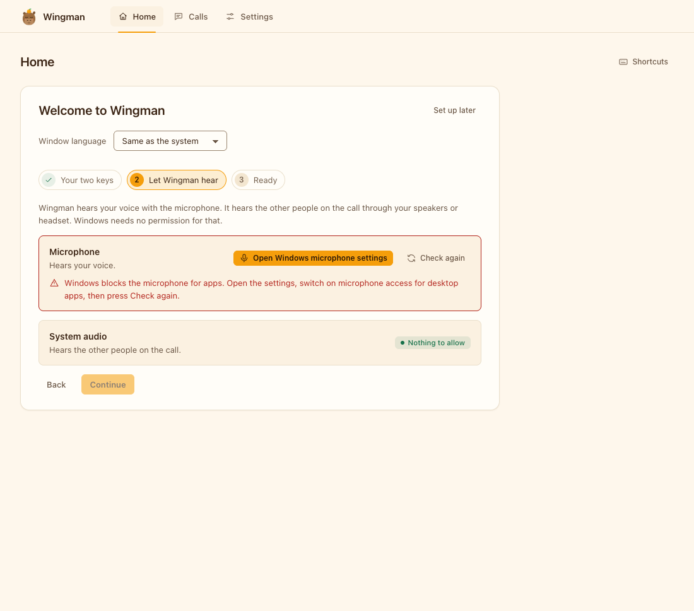
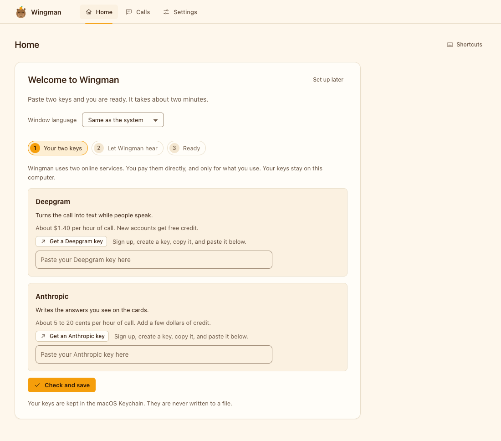
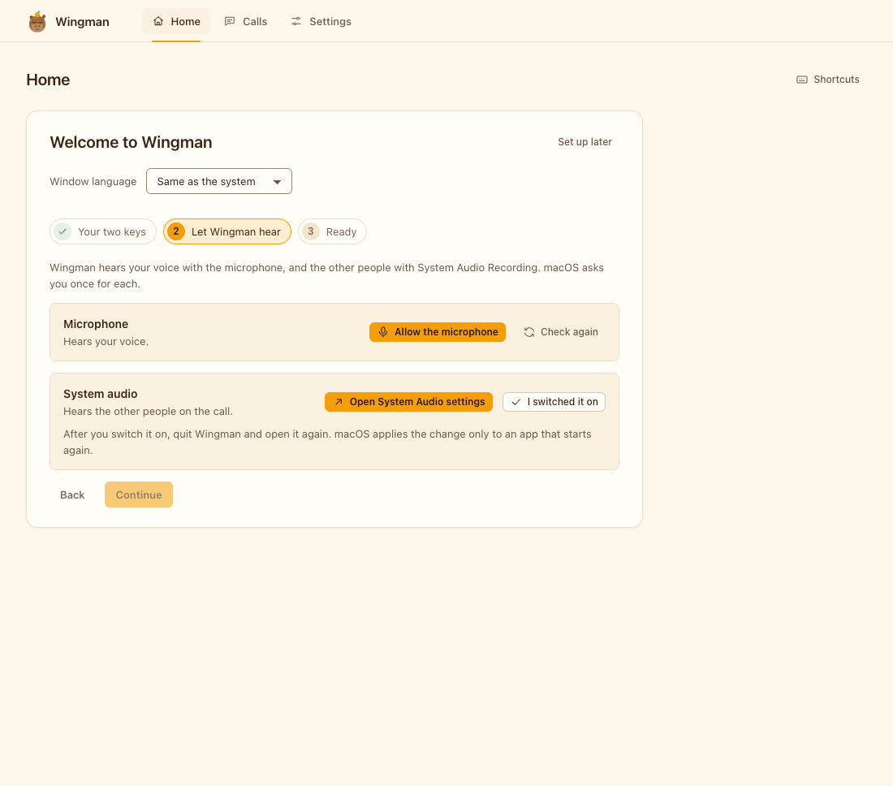
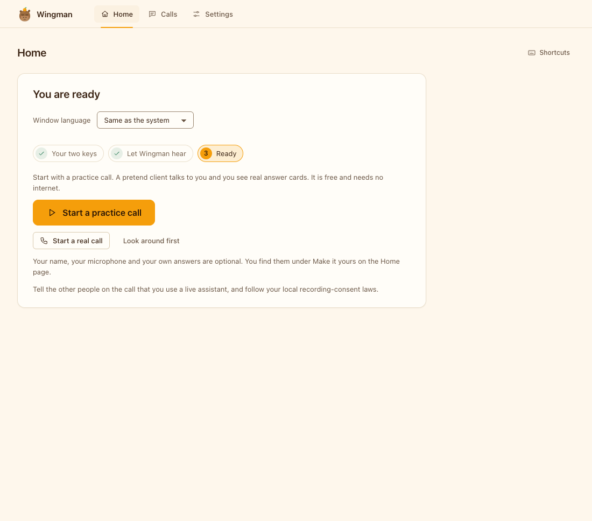
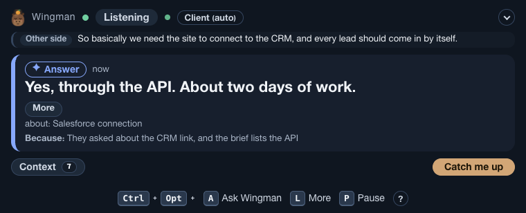
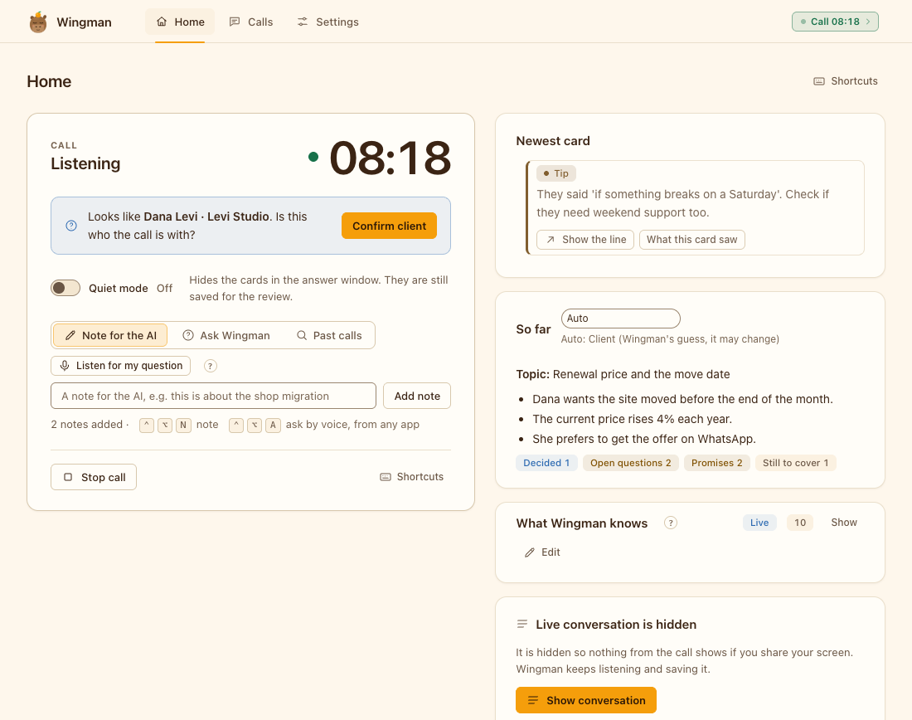
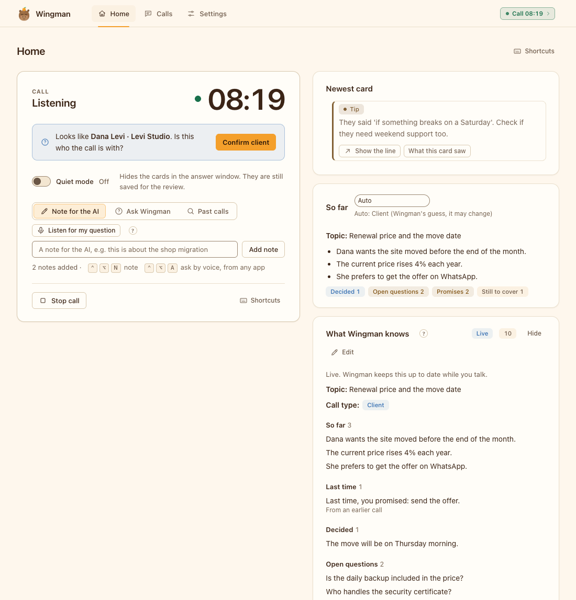

# Getting started

For someone who has just found Wingman and wants to use it on a real call. About 15 minutes to the first card, a few more for the rest. Developers who want to run the code first: [Development, Try it from the code](DEVELOPMENT.md#try-it-from-the-code-with-no-keys).

Four parts:

1. [Install the app](#part-1-install-the-app): download, open it once, paste the two keys.
2. [Try a practice call](#part-2-try-a-practice-call): a pretend client, free, no keys.
3. [Start a real call](#part-3-start-a-real-call), with optional context before it.
4. [Make your own pack](#part-4-make-your-own-pack): write your own answer cards.

## What Wingman does, in one minute

Wingman is a live agent for your meeting. It listens to both sides and builds context as the call goes: who is there, what was decided, which numbers were said, what you promised. From that it shows short cards on a second screen. **Live reading** is the default: the AI reads the whole call and decides when a card helps, so you also get help on objections, numbers and promises, not only on questions. **Classic** is the older mode that reacts to questions only. Keep it as a rollback (Settings, Advanced).

A **moment** is a point in the call where a short private nudge would help. Most lines are not a moment and get no card.

Before a meeting you can give it context (an invite, an email, notes). That is optional. With no context it still works: it learns from the call.

**Languages.** English and Hebrew, also mixed in one call. The default setting (`multi`) hears both. Other languages are not supported yet. See [Languages in the user guide](USER-GUIDE.md#languages).

## Part 1: Install the app

**Most people: download the app.** Open the [latest release](https://github.com/koren850/wingman/releases/latest) and take the file for your computer. You need no Node, no Homebrew and no ffmpeg. You need a second screen for the answer window. With one screen the answer window stays closed, so it cannot end up in a screen share (the call still works and cards are saved; you can allow the main screen in the setup, then never share it).

Both apps are **not signed yet**. Your system shows a warning the first time. It is expected, and the steps below get past it once.

### On a Mac (macOS 14.2 or newer, Apple Silicon)

1. Download `Wingman-<version>-arm64.dmg` and double-click it. A window opens with the Wingman icon and an Applications folder.
2. Drag **Wingman** onto **Applications**. Eject the disk image.
3. Open **Applications** and double-click **Wingman**. macOS says "Wingman Not Opened" because it cannot check the app for malware. Press **Done**. Do not press "Move to Bin".
4. Open **System Settings**, then **Privacy & Security**. Scroll down to the **Security** section. It says "Wingman was blocked to protect your Mac". Press **Open Anyway**. Enter your password or use Touch ID. In the last dialog press **Open Anyway** again.
5. The Wingman window opens and a small icon appears in the menu bar. Later starts open normally.

On macOS 15 and newer, the old way (right-click the app, then **Open**) no longer gets past this warning. If **Open Anyway** is missing or does nothing, open Terminal and run this once, then open Wingman again:

```bash
xattr -dr com.apple.quarantine /Applications/Wingman.app
```

The command removes the "downloaded from the internet" mark from the app. It changes nothing else.

**Permissions.** Wingman asks for **Microphone** (your voice) and **System Audio Recording** (the other side). The first window walks you through both. If Wingman is not in the System Audio Recording list, start a real call once and press **Allow** when macOS asks. After you allow System Audio Recording, quit and reopen Wingman: macOS gives no live status for it. Wingman does not need Screen Recording, Accessibility or Camera.

### On Windows (10 or 11, 64-bit)

1. Download `Wingman-Setup-<version>-x64.exe` and double-click it.
2. Windows may show a blue box, "Windows protected your PC" (SmartScreen), because the installer is not signed yet. Press **More info**, then **Run anyway**.
3. The installer does everything in one step. It installs for your user only, asks for no administrator rights, adds a **Wingman** shortcut to the Start menu and starts the app.
4. The Wingman icon is in the notification area at the bottom right. If you do not see it, press the small arrow to show hidden icons.
5. If Windows blocks the microphone, the first window has a button that opens the right Settings page ("Let desktop apps access your microphone"). Windows needs no permission for the sound of the other people on the call.



To remove Wingman, use **Settings, Apps, Wingman**. Your calls and notes stay in `%APPDATA%\Wingman` until you delete that folder. The Windows app records the microphone and the system audio itself. This has been tested with fakes only, not yet on a real Windows machine, so please report problems.

### The two keys

Wingman needs two keys. You paste them in the first window. That is the whole setup.

| Key | What it does | Where to get it | Cost |
|---|---|---|---|
| Deepgram | Turns speech into text | Sign up at [console.deepgram.com/signup](https://console.deepgram.com/signup), then create a key in the console | About $1.30 to $1.40 an hour of call |
| Anthropic | The AI (Claude) that reads the call, writes cards and the summary | Create an account at [platform.claude.com](https://platform.claude.com), add credit under Billing, create a key under [Settings, API keys](https://platform.claude.com/settings/keys) | About 5 to 20 cents an hour |

Open **Wingman**. The welcome window has three steps: **Your two keys**, **Let Wingman hear** and **Ready**.



Paste both keys and press **Check and save**. Each key is checked with one small request and saved only when the service accepts it. A wrong key, no credit and no network each give a plain message and a button that fixes it. Keys are stored in the macOS Keychain on a Mac, or encrypted for your account on Windows, never in a plain file. See the [user guide](USER-GUIDE.md#first-run).





From a terminal (developers): `pnpm keys set deepgram`, `pnpm keys set anthropic`, `pnpm keys status` (it says only whether a key is present). Never put keys in the repo.

**Cost (an estimate from the price table in the config).** A call costs about $1.50 an hour in total. Speech to text with Deepgram Nova-3 (two channels) is about $1.30 to $1.40 of that. The AI is about 5 to 20 cents an hour. In short test calls the whole call cost about $1.40 an hour, and about 90 percent of it was speech to text. A cap per call (`budget.maxUsdPerCall`, $2 by default) limits the AI spend, and Settings, Money has a soft cap per hour. Set a limit in both provider consoles too.

### Build from source (developers only)

Node is needed only to build and run the code, never to use the downloaded app. You need macOS 14.2 or newer (or Windows, see [Development](DEVELOPMENT.md#building-the-app-dmg-and-windows-installer)), Node 24 or newer (the installer does not install it), git and pnpm 11 (comes with corepack; run pnpm from `app/` so it uses the pinned version). `ffmpeg` is only for terminal runs and file replay: the app records the microphone itself.

```bash
brew install node@24                       # skip if you already have Node 24
git clone https://github.com/koren850/wingman.git
cd wingman
./install.sh --check                       # only reports what is present; changes nothing
./install.sh                               # checks the Mac, installs, builds Wingman.app
```

The installer never uses sudo. It asks before it copies the app to `/Applications`, adds the `wingman` command in `~/.local/bin` or runs `brew install ffmpeg` (only needed for terminal runs). It is safe to run again. `./install.sh --dry-run` shows every step; `--uninstall` removes it. Put `~/.local/bin` on your PATH (`export PATH="$HOME/.local/bin:$PATH"` in `~/.zshrc`). A `MISSING` line from `--check` tells you what to install; see [Troubleshooting](TROUBLESHOOTING.md#node-is-too-old-building-from-source) if Node is too old. The app built this way is also ad-hoc signed, so the first start needs the same **Open Anyway** step.

A Mac with no developer tools: install them first (each step is skipped if you already have it):

```bash
xcode-select --install                                  # git; finish the dialog that opens
/bin/bash -c "$(curl -fsSL https://raw.githubusercontent.com/Homebrew/install/HEAD/install.sh)"   # Homebrew, from brew.sh
eval "$(/opt/homebrew/bin/brew shellenv)"               # Apple silicon: brew on PATH for this shell
brew install node@24 && brew link --overwrite node@24   # Node 24 (or: nvm install 24)
corepack enable                                         # gives you pnpm; ./install.sh also does this
brew install ffmpeg                                     # developer file replay and terminal runs (the app does not need it)
brew install poppler                                    # optional: read PDF files as context
```

## Part 2: Try a practice call

Press **Practice call** in the setup, or next to **Start** on Home. A pretend client plays through the real call loop and the real answer window. It is free, needs no keys, and nothing leaves your Mac. The call is invented: a client called Dana asks about a slow site, backups and a price. It is in English when the interface language is English, in Hebrew otherwise. The speech and the AI replies in the practice call are **scripted**. It shows how the windows work, not how good the AI is.



What you see:

- The **answer window** (second screen): one big card, and older cards as small chips. Each card has a label: Prepared (from your pack, you wrote it), AI (check it before you say it), Buy time (a safe stalling line), Check (a number does not match), Prompt (a topic you wanted to cover), For you (an answer to something you asked), Math. Bars at the top show problems, such as the other side not being heard.
- The **Wingman window** (Home, Calls, Settings): the live call, the readiness state, and after the call the summary and a follow-up email draft.

The price question is the main idea: the client asks "how much" and Wingman shows a safe line, never an invented number. Prices, dates and promises are checked in code.





The Readiness check (Home, **Run readiness check**) tests the microphone, the system audio, the keys, the speech service and the AI. It ends with `READY`, `READY WITH WARNINGS` or `NOT READY` and tells you what to fix. The full check costs a few cents; `pnpm run doctor --offline` runs the free part. Without keys it ends with `NOT READY`, because missing keys count as errors.

## Part 3: Start a real call

**Optional: give Wingman context first.** On Home choose **Add meeting context**. Paste an invite, an email or notes, drop a file (.txt, .md, .docx, .eml, .pdf or .ics), give a web address (https), a calendar link, or choose your next calendar event. **Prepare** shows what Wingman understood. Before the call starts, Wingman shows **What Wingman knows** once: who is joining, the kind of call, and the facts, each with its source line. Untick or edit any line. **Start without review** is one click. If you add no context, this step is skipped.

Press **Start** on a meeting, or **Quick call** on Home. (Developers on a Mac can also run `wingman start --quick` from a terminal; the app asks you to confirm in a window.) Then talk, or join your call. Wingman builds its memory as you go ("So far" in the live view shows it). When it ends, press **Stop call** and then **Open summary**. Wingman saves the transcript and writes a summary and a follow-up email draft. Everything is in `~/Library/Application Support/Wingman/calls/` on a Mac and `%APPDATA%\Wingman\calls\` on Windows. See [EXAMPLES.md](EXAMPLES.md#d-a-call-summary-and-follow-up-email) for what the summary looks like.

Tell the people you talk to that you use a call assistant if the law or your rules ask for it. See [Privacy and security](PRIVACY-AND-SECURITY.md).

## Part 4: make your own pack

A **pack** is plain files: your answer cards, your tone rules and two word lists. The format is in [PACK-FORMAT.md](PACK-FORMAT.md). A worked, tested example is in [EXAMPLES.md](EXAMPLES.md#a-a-full-pack).

### 1. Copy a starter pack

In the app: **Settings, Setup guide, Starter answers**. Pick a starter (sales, customer support, job interview practice, an empty pack, or the web hosting example) and press **Copy to my folder**. The starters are in Hebrew, with English text for English calls. Or by hand (swap `example-pack` for `starter-packs/sales`, `support`, `interview` or `empty`):

```bash
mkdir -p ~/.config/wingman/pack
cp -R app/data/example-pack/. ~/.config/wingman/pack/     # run from the repository root
```

Instead of writing cards by hand, you can let a model draft them from your own FAQ or notes. In `app/`, run `pnpm run pack:from-notes <file.txt|.md|.pdf>` (one model call, a few cents). It writes a draft folder; every card goes through the guards, and a card with a price, date or promise becomes a stall line. Nothing is written into your live pack: read the draft and copy what you want. Details: [PACK-FORMAT.md](PACK-FORMAT.md).

Wingman looks in `~/.config/wingman/pack/` first (or in the folder named by `WINGMAN_PACK_DIR`), and nothing else. With no pack you have no prepared cards until you copy a starter pack or write one. The practice call and the demo use the example pack. If your pack has its own `bank.yaml`, files it lacks are filled from the example pack, and the Readiness check lists them. Copy all five files so none of the invented example text mixes in.

### 2. Edit `bank.yaml`

One card looks like this:

```yaml
- id: backups
  title: Backups
  triggers: [backup, backups, restore, "do you have a backup"]
  say: Yes, we can set up automatic backups of the files and the database, and restore from them if something goes wrong.
  facts: [Files and database, Keep a copy off the server, How often depends on the plan]
```

Write what people really say in `triggers`. Write `say` as one or two short sentences you would say out loud. No prices, no dates, no promises.

### 3. Check that it loads and matches

To test a pack in a folder without touching your real one, point `WINGMAN_PACK_DIR` at it. From `app/`:

```bash
WINGMAN_PACK_DIR=/path/to/my-pack ./node_modules/.bin/tsx -e '
import { loadBank, matchBankFor } from "./src/bank.ts";
const bank = loadBank();
console.log(bank.length + " cards loaded");
const hit = matchBankFor(process.argv[1], bank);
console.log(hit ? hit.card.id + ": " + hit.card.say : "no card");
' "do you have a backup"
```

With the example pack from [EXAMPLES.md](EXAMPLES.md) this printed:

```text
7 cards loaded
backups: Yes, we can set up automatic backups of the site and the database, and restore from them if something goes wrong.
```

A broken card stops with a clear error, for example `bad bank card: {"id":"x"}` for a card with no `say` and no `triggers`. Duplicate ids are errors too.

Try a few real sentences. If the wrong card appears, add a longer phrase to the right card. A phrase of several words counts for more than one word.

### 4. Add the other files

- `bank.en.yaml` for English versions of the cards.
- `house-style.md` for tone and never-say rules, sent to the AI.
- `keyterms.txt` with product names and tech words, to help speech to text.
- `topics.txt` with words that mean "this call is about my work".

All of them are explained, with examples, in [EXAMPLES.md](EXAMPLES.md).

### 5. Run the Readiness check

In the app, **Home, Run readiness check**. It shows how many cards loaded, whether the ids are unique, and which files still come from the example pack. Changes apply to the next call.

Next: [Examples](EXAMPLES.md) · [User guide](USER-GUIDE.md) · [Pack format](PACK-FORMAT.md)
