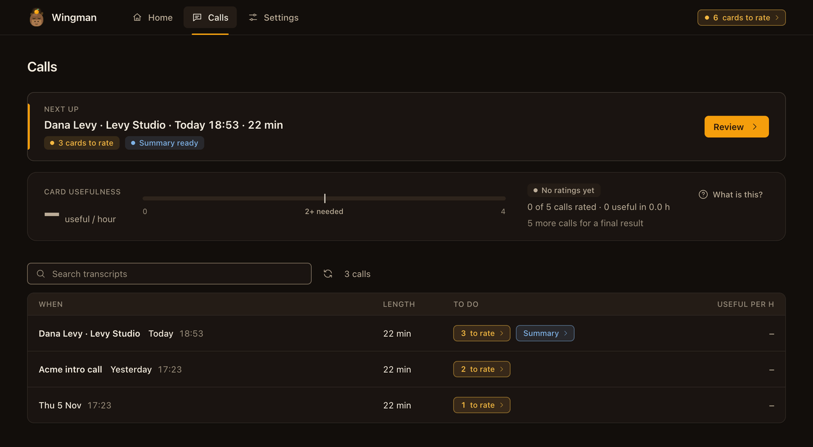
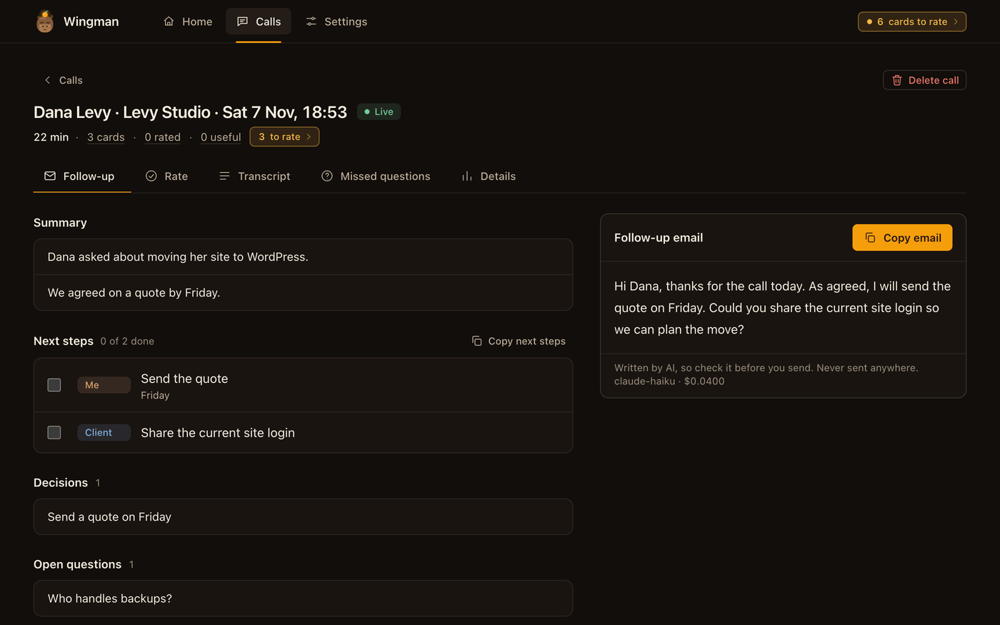
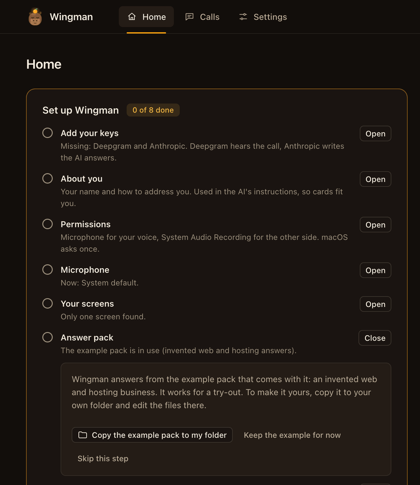

# User guide

For people who have installed Wingman and use it on calls. It covers everyday use of Wingman after it is installed: first run, updating, where your files live, profile and pack, practice and prep mode, flow mode and the command line. For install and requirements see the [README](../README.md); for a first walk-through see [Getting started](GETTING-STARTED.md); for every setting and hotkey see [app/README.md](../app/README.md).

Contents: [First run](#first-run) · [Tour of the windows](#tour-of-the-windows) · [Update and uninstall](#update-and-uninstall) · [Where your files live](#where-your-files-live) · [Profile and pack](#profile-and-pack) · [Practice and prep mode](#practice-and-prep-mode) · [Flow mode](#flow-mode) · [Command line](#command-line)

## First run

Open **Wingman** (Spotlight or Launchpad). The first window is a guided setup:

1. **Keys.** Paste your Deepgram and Anthropic keys. They go into the macOS Keychain.
2. **About you.** Your name and how to address you. (Also in Settings later.)
3. **Permissions.** Allow the microphone and System Audio Recording. After you allow System Audio Recording, **quit and reopen Wingman**. macOS gives no live status for it.
4. **Microphone.** Pick the one you use. Avoid AirPods for the first call.
5. **Your screens.** With one screen, you can allow the answer window on it. Never share that screen.
6. **Answer pack.** Use the invented example pack, or copy it to your own folder and edit it.
7. **Readiness check.** Tests the mic, system audio, keys, speech service and the AI.
8. **Practice call.** A pretend client plays through the real call loop and the real answer window. Free, and nothing leaves your Mac.

Every step can be skipped and reopened from **Settings, Setup guide**. When you are ready, press **Quick call**, or **Start** on a prepared meeting.

Without the app, from the terminal: `cd app && pnpm dashboard`. See [app/README.md](../app/README.md) for all commands, settings and hotkeys.

Notes:
- `pnpm run doctor`, not `pnpm doctor` (the second one is pnpm's own command).
- Never put keys in the repo. They belong in the Keychain.
- No second screen yet? Turn on the one-screen option in the setup, and never share that screen.

## Tour of the windows

All pictures use invented data. The client, the numbers and the answers are made up.

### The answer window

This is the window you read during a call. Put it on the second screen.


1. **Listening** (top): Wingman hears the call. It says **Paused** when you pause it.
2. **Other side**: the last thing the other person said.
3. **AI · unverified** (dashed border): an answer written by the AI. Check it before you say it. A line starting "Answering:" shows which question it answers.
4. **Prepared** (green, not shown here): an answer from your own answer pack. You wrote it, so you can trust it more.
5. **Buy time**: a safe line to say while you check a number. Wingman uses it instead of inventing a price or a date.
6. **Numbered chips** (Phone, Email, Domain): details heard in the call. Press Ctrl+Opt and the number to copy one.
7. **You have not talked about:** your checklist of topics still open. **Levy Electronics** is the client card. **AI notes** are points the AI noticed.
8. **Bottom bar**: the hotkeys. Ctrl+Opt+A asks the AI, R shows what they said, L opens the checklist, P pauses, C clears.

### Home, during a call


1. **Timer and state**: how long the call has run, and whether Wingman is listening.
2. **Looks like ... Confirm client**: Wingman guesses who the call is with. Press **Confirm client** if it is right. The AI then gets that client's details.
3. **Quiet mode**: hides the cards in the answer window. They are still saved for the review.
4. **Note for the AI** and **Ask Wingman**: type a short note, or ask a question. **Listen for my question** lets you ask by voice.
5. **Show conversation**: the live text is hidden so it does not appear if you share your screen.
6. **Stop call** ends the call. **Delete this call...** stops it and removes everything saved from it.

### Calls



1. **Next up**: the call that most needs you. **Review** opens it.
2. **Card usefulness**: how many useful cards you get per hour. It needs a few rated calls before it shows a result.
3. **Search transcripts**: find a word in all your calls.
4. **To do** column: **3 to rate** means three cards wait for a rating. **Summary** opens the written summary.

### One call: Follow-up



1. **Live** or **Practice** shows what kind of call it was. **Delete call** removes it.
2. **Tabs**: **Follow-up**, **Rate** (mark each card useful or not), **Transcript**, **Missed questions** (questions with no card) and **Details**.
3. **Next steps**: tick them off when done. **Me** is for you, **Client** is for the other side.
4. **Follow-up email**: a draft written by the AI. Read it, then press **Copy email**. Wingman never sends anything.

### Setup guide



1. **Set up Wingman** shows how many of the 8 steps are done.
2. **Open** shows the details of a step. **Close** hides them again.
3. Each step explains what it is for. Here, the **Answer pack** step lets you copy the example pack to your own folder, or keep the example for now.
4. **Skip this step** is always allowed. You can come back from **Settings, Setup guide**.

## Update and uninstall

```bash
wingman update                 # git pull (fast-forward only), install, rebuild the app
wingman uninstall              # removes the app copies and the wingman link; your data stays
wingman uninstall --purge      # also deletes your data and settings, after you type DELETE
```

The same work is done by `./install.sh --update` and `./install.sh --uninstall [--purge]`. The app starts from the folder you cloned. If you move that folder, run `./install.sh` again from the new place.

## Where your files live

Nothing about you is stored in this repository.

| Folder | What is there |
|---|---|
| `~/Library/Application Support/Wingman/` | Your data: `calls/` (transcripts, cards, summaries), `briefs/` (prepared meetings, with `briefs/attachments/`), `entities.json` (optional client snapshot). Override with `WINGMAN_DATA_DIR`. |
| `~/.config/wingman/` | `settings.yaml`, `profile.yaml`, `pack/`, and the old `keys.env` if you still have one. |
| macOS Keychain, service `wingman` | Your API keys. |

If you used an older version that kept calls in the repo folder (`calls/` and `data/private/` inside the repo folder, `stage0/`), the first start **copies** them to the new folder. It never moves or overwrites. The old folders stay until you delete them.

## Profile and pack

- A **profile** file (`~/.config/wingman/profile.yaml`): your name and spellings, how to address you in Hebrew, a short "about", your business and your time zone (for example `Asia/Jerusalem`). Set it in **Settings, About you**, or from the terminal (see `wingman help`):

  ```bash
  wingman profile set --name Dana --spelling Dana --address female --timezone Asia/Jerusalem
  wingman profile show
  ```
- A **pack** folder (`~/.config/wingman/pack/`, or `WINGMAN_PACK_DIR`): your answer bank, house style, keyterms and topic words. Without one, the invented example web/hosting pack in `app/data/example-pack/` is used. File formats: [docs/PACK-FORMAT.md](PACK-FORMAT.md).

Do not confuse these with a **settings preset** (`app/profiles/<name>.yaml`, used with `--profile <name>`). A preset is a set of setting overrides, such as `first-client-call`. It has nothing to do with `profile.yaml`.

## Practice and prep mode

A mock-interview and practice coach: rehearse with your own notes, get suggested answers in your own words, and review after the call. It is not for live use in a real interview. Create a prepared meeting with kind `interview` (`wingman plan new --kind interview ...`; the kind is set from the command line). Attach your prep notes as background files.

In this mode:

- Every question gets an answer, with no card limit.
- There are no "Buy time" lines.
- Answers are built from your notes only, never invented experience.
- The AI may not write a salary figure. Salary comes only from your own prepared card.
- There are no fact cards and no self-check cards.
- To use your own prepared answers, add the meeting note `Prepared cards: /full/path/cards.yaml`. The file has the same format as the answer bank ([docs/PACK-FORMAT.md](PACK-FORMAT.md#cards-for-a-practice-meeting)). For that call it replaces the normal bank. Each meeting can point to its own file.

Real interviews and exams that forbid outside help are out of scope ([ADR 35](DECISIONS.md#adr-35-scope-no-real-job-interviews-or-exams)). You are responsible for following the rules that apply to you.

## Flow mode

For calls with several people on the other side (needs `stt.speakers`, on by default; turn flow off with `flow.enabled: false`).

- When two or more of them talk to each other and you are quiet, a muted line shows who is talking and about what. Answer cards wait (`flow.holdCards`). Price and date cards, and questions with your name, still show.
- When someone turns to you (says your name, or "you" right after their own discussion), an orange alert shows who.
- Nothing is kept between calls. Names only live for the call.

## Command line

```bash
cd app
pnpm -s wingman help         # full help
pnpm -s wingman status       # is the app running, is a call live
pnpm -s wingman start --practice
pnpm -s wingman start --quick           # no Plan; or: wingman plan list, then wingman start --plan <id>
```

After `./install.sh` you can type `wingman ...` from any folder.

A prepared meeting for a client call, then a start (these talk to the running app, so open Wingman first):

```bash
wingman plan new --title "Hosting move" --at "2026-11-03 14:30" --who "Dana, Levi Studio" --kind client \
  --topic "hosting move" --goal "agree migration date" --must "price" --must "downtime window"
wingman plan list                  # shows the id of each meeting
wingman start --plan <id>          # or: wingman start --quick
wingman live --follow              # transcript and cards in the terminal
wingman stop                       # saves the call and writes the summary
wingman calls summary latest       # read the summary
```

The `wingman` command talks to the running menu-bar app over an owner-only local socket. It cannot read API keys. By default the app asks you in a window before it starts a real call that came from the command line (setting `privacy.askBeforeCliStart`), and before it deletes a call.

Next: [Examples](EXAMPLES.md) · [Pack format](PACK-FORMAT.md) · [Troubleshooting](TROUBLESHOOTING.md) · [Privacy and security](PRIVACY-AND-SECURITY.md)
