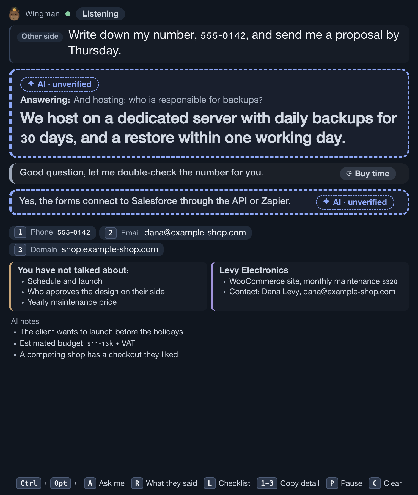
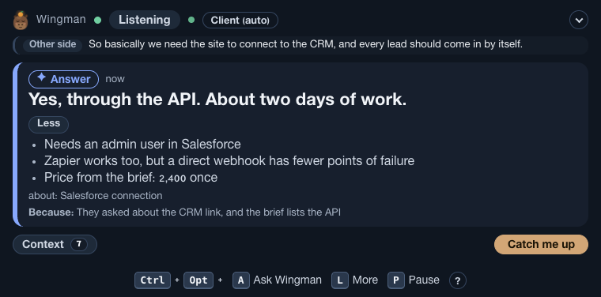
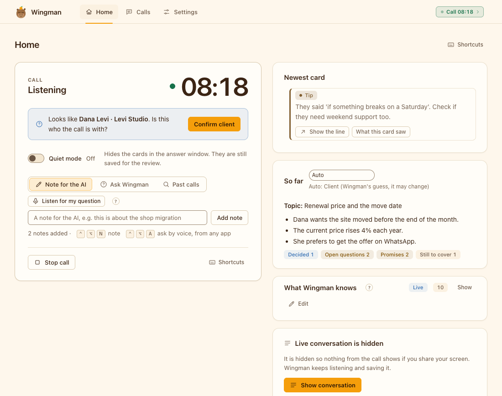
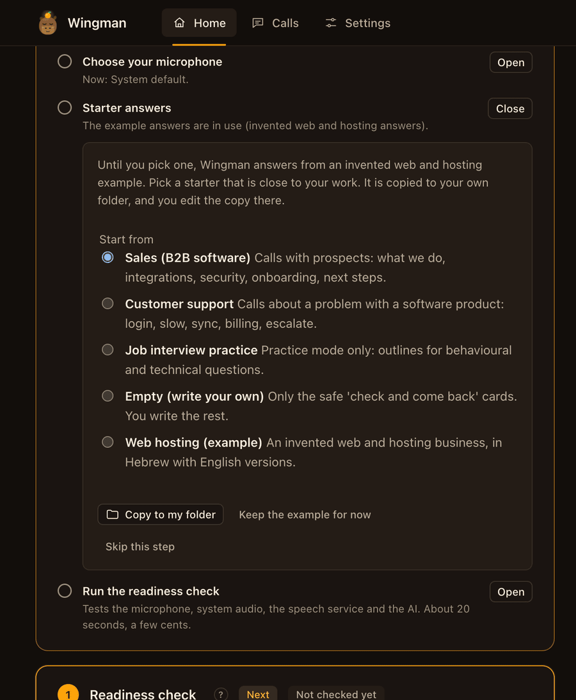

# User guide

For people who have installed Wingman and use it on calls. It covers everyday use of Wingman after it is installed: first run, updating, where your files live, profile and pack, practice and prep mode, group call mode, words used in Wingman and the command line. For install and requirements see the [README](../README.md); for a first walk-through see [Getting started](GETTING-STARTED.md); for every setting and hotkey see [app/README.md](../app/README.md).

Contents: [First run](#first-run) · [Tour of the windows](#tour-of-the-windows) · [Update and uninstall](#update-and-uninstall) · [Where your files live](#where-your-files-live) · [Profile and pack](#profile-and-pack) · [Practice and prep mode](#practice-and-prep-mode) · [Group call mode](#group-call-mode) · [Words used in Wingman](#words-used-in-wingman) · [Command line](#command-line)

## First run

Open **Wingman** (Spotlight or Launchpad). The first window is a guided setup with three steps. The chip at the top shows your progress, for example "2 of 3".

1. **Try it.** A practice call: a pretend client plays through the real call loop and the real answer window. Free, no keys, and nothing leaves your Mac.
2. **Connect.** Paste your Deepgram and Anthropic keys. They go into the macOS Keychain. Press **Test** to check each one. The step shows the cost: about $1.40 per hour of call for Deepgram plus roughly 5 to 20 cents an hour for Anthropic.
3. **Allow.** Allow the microphone and System Audio Recording. After you allow System Audio Recording, **quit and reopen Wingman**: macOS gives no live status for it. Then choose your screens. Wingman shows its answers in a small window on a second screen, because that window must never be in your screen share. With one screen the answer window stays closed (the call still works, and every answer is saved in the Wingman window). You can allow the window on your one screen, but then never share that whole screen.

Then it says "You're ready". Press **Quick call**, or **Start** on a saved meeting. The way to your first real card is three steps on screen: Connect (keys), Allow (microphone and system audio, then quit and open Wingman once) and Try it (a free practice call).

**Meeting context (optional).** Choose **Add meeting context** to give Wingman background before a call: paste an invite, an email or notes, or drop a .txt, .md, .pdf or .ics file. Under **More details** you can add who is joining, the goal and what you must cover. **Prepare** shows what Wingman understood; you can fix or remove any line. A saved meeting stays until you delete it and can start many calls. The window language is under Settings, Window language (English, Hebrew, or the system language).

The Wingman window itself is in English only. The setting `ui.language` (Settings, Audio and screens) sets the language of the labels in the answer window: `auto` shows Hebrew unless the speech language is English; `he` and `en` force one.

Below the three steps is **Make it yours (optional)**. Nothing in it is needed to start, and each item can be skipped:

- **About you.** Your name and how to address you. (Also in Settings later.)
- **Your privacy.** Two choices: ask before listening starts, and keep your audio out of Deepgram's model training.
- **Choose your microphone.** Pick the one you use. Avoid AirPods for the first call.
- **Starter answers.** Pick a starter (sales, customer support, job interview practice, empty, or the web hosting example). It is copied to your own folder and you edit the copy.
- **Run the readiness check.** Tests the mic, system audio, keys, speech service and the AI.

Every step can be skipped and reopened from **Settings, Setup guide**.

Without the app, from the terminal: `cd app && pnpm dashboard`. See [app/README.md](../app/README.md) for all commands, settings and hotkeys.

Notes:
- `pnpm run doctor`, not `pnpm doctor` (the second one is pnpm's own command).
- Never put keys in the repo. They belong in the Keychain.
- No second screen yet? Turn on the one-screen option in the setup (step 3, Allow), and never share that screen.

## Tour of the windows

All pictures use invented data. The client, the numbers and the answers are made up.

### The answer window

This is the window you read during a call. Put it on the second screen. By default it uses the **Focus** layout: what they said, one big answer, one small line for the answer before it, and a **More** button. In **Settings, Answer window layout** you can switch to **Full**, which shows everything at once.

**Help engine (Settings, Answers).** *Classic* shows a card when the other side asks a question. *New (live reading)* lets the AI read the whole call and decide when a card helps: a question, an objection, a number that does not fit, a term you may not know, a point you planned to cover. Most lines get no card. A prepared card or a sum shows first; an AI card replaces it only if it is better. If you say a number that does not match your notes, you get a Check card. The New engine keeps a short memory of the call and costs about 3 US cents an hour for this part (Settings, Money, has a soft cap per hour). It is off in practice interviews. Takes effect on the next call.



1. **Listening** (top): Wingman hears the call. It says **Paused** when you pause it. Next to it are two small dots: the first shows the call state, the last one is the health dot. Green means everything works, amber means something is degraded (for example a weak microphone), red means something is not working. Hover over it to read the reason.
2. **Other side**: the last thing the other person said.
3. **AI · unverified** (dashed border): the one big answer, written by the AI. Check it before you say it. A line starting "Answering:" shows which question it answers.
4. **Prepared** (green, not shown here): an answer from your own answer pack. You wrote it, so you can trust it more.
5. **Buy time**: the small line under the big card. It is the answer before this one. Here it is a safe line to say while you check a number. Wingman uses it instead of inventing a price or a date.
6. **More: 8** (Ctrl+Opt+L): opens the extra panel, shown next. It closes by itself after a while.
7. **Key bar** (bottom): Ctrl+Opt+A asks the AI, L opens More, P pauses. Press **?** to see all of them (R shows what they said, C clears, 1-3 copy a detail).
8. **Writing...**: while an AI answer is still arriving, its label says so. Wait until it stops before you read it out.

#### The More panel



1. **Numbered chips** (Phone, Email, Domain): details heard in the call. Press Ctrl+Opt and the number to copy one.
2. **You have not talked about:** your checklist of topics still open.
3. **Levy Electronics** is the client card. **AI notes** are points the AI noticed.

In the Full layout all of this is on screen all the time.

### Home, during a call



1. **Timer and state**: how long the call has run, and whether Wingman is listening. The dot next to the timer is green while it listens, and amber or red if something needs attention.
2. **Looks like ... Confirm client**: Wingman guesses who the call is with. Press **Confirm client** if it is right. The AI then gets that client's details.
3. **Quiet mode**: hides the cards in the answer window. They are still saved for the review.
4. **Note for the AI** and **Ask Wingman**: type a short note, or ask a question. **Listen for my question** lets you ask by voice.
5. **Show conversation**: the live text is hidden so it does not appear if you share your screen.
6. **Stop call** ends the call. **Delete this call...** stops it and removes everything saved from it.

### Calls


1. **Next up**: the call that most needs you. **Review** opens it.
2. **Card usefulness**: how many useful cards you get per hour. It needs a few rated calls before it shows a result.
3. **Search transcripts**: find a word in all your calls.
4. **To do** column: **3 to rate** means three cards wait for a rating. **Summary** opens the written summary.

### One call: Follow-up


1. **Live** or **Practice** shows what kind of call it was. **Delete call** removes it.
2. **Tabs**: **Follow-up**, **Rate** (mark each card useful or not), **Transcript**, **Missed questions** (questions with no card) and **Details**.
3. **Next steps**: tick them off when done. **Me** is for you, **Client** is for the other side.
4. **Follow-up email**: a draft written by the AI. Read it, then press **Copy follow-up email** (big button at the top; **Copy summary** is next to it). Placeholders such as `[fill in: ...]` are highlighted. A finished call opens on this tab. Rating cards (**Rate**) is optional. Wingman never sends anything.

### Setup guide


1. **Set up Wingman** shows how many of the 3 steps are done ("2 of 3"). The first step, **Try it**, is a free practice call: a pretend caller talks to Wingman on your Mac, so you can see the windows before you pay for anything.
2. **Open** shows the details of a step. **Close** hides them again.
3. **Connect** has the two key fields (Deepgram and Anthropic). Paste a key, press **Save**, then **Test**. **Allow** covers the microphone, System Audio Recording and your screens.
4. **Make it yours (optional)** lists About you, Your privacy, Choose your microphone, Starter answers and the readiness check.
5. **Skip this step** is always allowed. You can come back from **Settings, Setup guide**.

The **Starter answers** item offers starter packs, so you do not begin with an empty folder:



1. **Start from**: pick the starter closest to your work. **Web hosting (example)** is the invented example Wingman uses until you choose.
2. **Copy to my folder** copies the starter to your own pack folder. You edit the copy there. **Keep the example for now** changes nothing.

## Update and uninstall

```bash
wingman update                 # git pull (fast-forward only), install, rebuild the app
wingman uninstall              # removes the app copies and the wingman link; your data stays
wingman uninstall --purge      # also deletes your data and settings, after you type DELETE
```

The same work is done by `./install.sh --update` and `./install.sh --uninstall [--purge]`. The app starts from the folder you cloned. If you move that folder, run `./install.sh` again from the new place.

## Where your files live

Nothing about you is stored in this repository.

| Folder | What is there |
|---|---|
| `~/Library/Application Support/Wingman/` | Your data: `calls/` (transcripts, cards, summaries), `briefs/` (prepared meetings, with `briefs/attachments/`), `entities.json` (optional client snapshot). Override with `WINGMAN_DATA_DIR`. |
| `~/.config/wingman/` | `settings.yaml`, `profile.yaml`, `pack/`, and the old `keys.env` if you still have one. |
| macOS Keychain, service `wingman` | Your API keys. |

If you used an older version that kept calls in the repo folder (`calls/` and `data/private/` inside the repo folder, `stage0/`), the first start **copies** them to the new folder. It never moves or overwrites. The old folders stay until you delete them.

## Profile and pack

- A **profile** file (`~/.config/wingman/profile.yaml`): your name and spellings, how to address you in Hebrew, a short "about", your business and your time zone (for example `Asia/Jerusalem`). Set it in **Settings, About you**, or from the terminal (see `wingman help`):

  ```bash
  wingman profile set --name Dana --spelling Dana --address female --timezone Asia/Jerusalem
  wingman profile show
  ```
- A **pack** folder (`~/.config/wingman/pack/`, or `WINGMAN_PACK_DIR`): your answers (the file `bank.yaml`), house style, keyterms and topic words. Without one, the invented example web/hosting pack in `app/data/example-pack/` is used. File formats: [docs/PACK-FORMAT.md](PACK-FORMAT.md).
- **Build answers from your notes.** If you have an FAQ file, `pnpm run pack:from-notes <file.txt|.md|.pdf>` (in `app/`) drafts the cards for you into a separate folder. You read and fix them, then copy them into your pack. Prices, dates and promises in your notes become safe "I will check" cards. Details: [Build answers from your notes](PACK-FORMAT.md#build-answers-from-your-notes).

Do not confuse these with a **settings preset** (`app/profiles/<name>.yaml`, used with `--profile <name>`). A preset is a set of setting overrides, such as `first-client-call`. It has nothing to do with `profile.yaml`.

## Practice and prep mode

A mock-interview and practice coach: rehearse with your own notes, get suggested answers in your own words, and review after the call. It is not for live use in a real interview. Create a prepared meeting with kind `interview` (`wingman plan new --kind interview ...`; the kind is set from the command line). Attach your prep notes as background files.

In this mode:

- Every question gets an answer, with no card limit.
- There are no "Buy time" lines.
- Answers are built from your notes only, never invented experience.
- The AI may not write a salary figure. Salary comes only from your own prepared card.
- There are no fact cards and no self-check cards.
- To use your own prepared answers, add the meeting note `Prepared cards: /full/path/cards.yaml`. The file has the same format as the answer bank ([docs/PACK-FORMAT.md](PACK-FORMAT.md#cards-for-a-practice-meeting)). For that call it replaces the normal bank. Each meeting can point to its own file.

Real interviews and exams that forbid outside help are out of scope ([ADR 35](DECISIONS.md#adr-35-scope-no-real-job-interviews-or-exams)). You are responsible for following the rules that apply to you.

## Group call mode

For calls with several people on the other side (needs `stt.speakers`, on by default; turn it off with `flow.enabled: false`). The setting keys still start with `flow`.

- When two or more of them talk to each other and you are quiet, a muted line shows who is talking and about what. Answer cards wait (`flow.holdCards`). Price and date cards, and questions with your name, still show.
- When someone turns to you (says your name, or "you" right after their own discussion), an orange alert shows who.
- Nothing is kept between calls. Names only live for the call.

## Words used in Wingman

The window uses plain words. Some older docs, file names and settings keep the internal names. This table links the two. Names in files and settings did not change.

| Old or internal term | Name in the app | What it means |
|---|---|---|
| Bank, answer bank (`bank.yaml`) | Your answers | The answers you wrote before the call. Cards from it are marked **Prepared**. |
| Pack, answer pack | Starter answers / your answers folder | The folder of your answers, tone rules and word lists. |
| Bank card | Prepared | An answer from your own files. Local and instant. |
| AI card | AI · unverified | An answer written by the AI. Check it before you say it. |
| Stall line | Buy time | A safe line to say while the real answer is found. |
| Call frame | About the call | What kind of call it is, its topic and goal, and a checklist of what to cover. |
| Frame kind | Client, Support, Vendor, Team, Consult, Personal, Interview, Other | The kind of call. |
| Flow mode | Group call mode | Several people on the other side: cards wait while they talk to each other. |
| Capture chip | Detail 1 to 3 (phone, email, domain) | Details Wingman picked up, ready to copy. |
| Reflex | Answers (in the cost table) | The part that writes answers while someone speaks. |
| STT | Speech to text | Turns the call audio into text. Shown as a cost. |
| LLM | AI | The model that writes answers. Shown as a cost. |
| Haiku tag | AI decision | What the AI chose for a question: No card, Buy time, Prepared or AI. |
| Latency | Time to answer | How long after the question a card showed. |
| Degrade ladder, rung | Health bar | The steps Wingman takes when something is slow or down. |
| Brief, plan, prepared meeting | Plan, prepared meeting | The notes for one specific call. |
| Doctor | Readiness check | Tests the microphone, system audio, keys and services. |

## Ask the call and Catch me up

- **Catch me up** (Ctrl+Opt+U): a sheet with five lines: where we are, decided, open, you promised, they asked of you. It fills in about two seconds. `wingman recap` prints the same in the terminal.
- **Ask the call**: type `ask what did they say about the deadline?` or run `wingman ask "..."`. Wingman looks in what it learned in the call, then in the transcript, then uses general knowledge. If the call does not say, it says so. It never invents a number.
- **Follow-up**: `wingman followup` prints a draft message for the other side from the saved call. Prices, dates and promises show as `[fill in]` for you to complete.
- **Pre-meeting digest**: `wingman digest` reads pasted notes and files and finds people, agenda, facts and likely questions. This is optional. With no AI, the raw text is kept as background.
- **Meeting context box**: one box for everything Wingman should know before a call. Paste text, drop a file (.txt, .md, .docx, .eml, .pdf, .ics), type a web address, or press "Use my next calendar event". Below the box, "Wingman understood: ..." says what it took from it, and "What Wingman knows" lists each fact with where it came from. You can remove any fact.
- **Web addresses and calendar**: only public https pages are read (8 seconds, 1 MB). Addresses inside your network are refused. For the calendar, paste the private .ics address from your calendar settings into Settings, "My calendar address". Wingman picks the meeting nearest to now, shows it, and uses it only after you say yes. A `.docx` file needs the `unzip` tool, which macOS and Linux have.
- **Last time**: when a person on the call was on an earlier call, the new call starts with up to 5 short notes (open promises first, then the last topic). The first time that person is named, one Fact card may show a note. This is local and uses no AI call. Turn it off with "Remember people from earlier calls".
- When the AI is offline, answers come from your notes and are labelled "AI offline: from notes".

## Command line

```bash
cd app
pnpm -s wingman help         # full help
pnpm -s wingman status       # is the app running, is a call live
pnpm -s wingman start --practice
pnpm -s wingman start --quick           # no Plan; or: wingman plan list, then wingman start --plan <id>
```

After `./install.sh` you can type `wingman ...` from any folder.

A prepared meeting for a client call, then a start (these talk to the running app, so open Wingman first):

```bash
wingman plan new --title "Hosting move" --at "2026-11-03 14:30" --who "Dana, Levi Studio" --kind client \
  --topic "hosting move" --goal "agree migration date" --must "price" --must "downtime window"
wingman plan list                  # shows the id of each meeting
wingman start --plan <id>          # or: wingman start --quick
wingman live --follow              # transcript and cards in the terminal
wingman stop                       # saves the call and writes the summary
wingman calls summary latest       # read the summary
```

The `wingman` command talks to the running menu-bar app over an owner-only local socket. It cannot read API keys. By default the app asks you in a window before it starts a real call that came from the command line (setting `privacy.askBeforeCliStart`), and before it deletes a call.

Next: [Examples](EXAMPLES.md) · [Pack format](PACK-FORMAT.md) · [Troubleshooting](TROUBLESHOOTING.md) · [Privacy and security](PRIVACY-AND-SECURITY.md)
